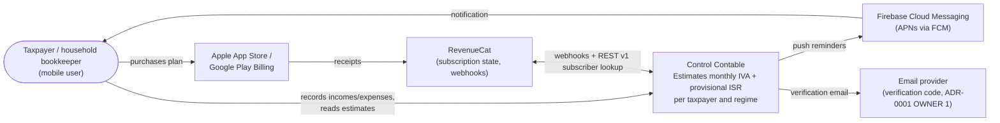
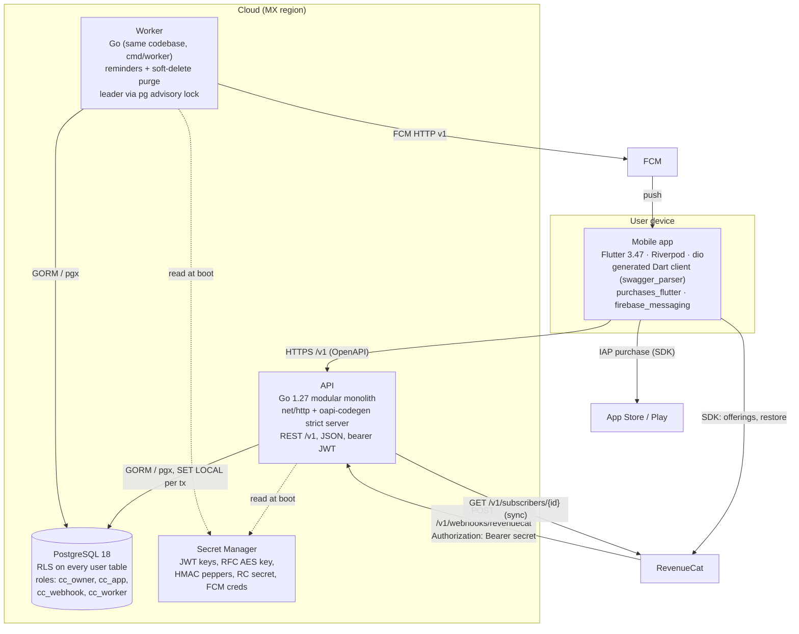
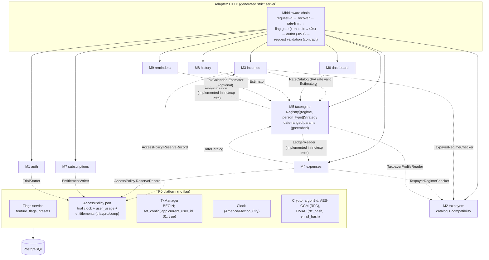

# C4 — Control Contable

| Field | Value |
|---|---|
| Status | PROPOSED (Phase 2 Design) |
| Date | 2026-10-13 |
| Related | [ADR-0001](../adr/0001-stack.md), [ADR-0002](../adr/0002-tax-engine.md), [data model](data-model.md), [OpenAPI](../api/openapi.yaml) |

The diagrams are Mermaid flowcharts (more portable than Mermaid's experimental C4 syntax).
Hosting follows the ADR-0001 recommendation (Cloud Run + Cloud SQL, MX region), which the
owner still has to confirm.

## 1. System context



There are no SAT, CFDI or bank integrations (NG2, NG5). Nothing is filed (NG1).

## 2. Containers



## 3. Components (API container)

Every module has `domain/ → usecase/ → adapter/http, infra/`, and dependencies point
inward. Modules interact only through consumer-owned ports (dashed arrows), never by
importing each other's packages.



### Module boundaries (vertical slices)

| Module | Owns tables | Consumes ports | If flag OFF |
|---|---|---|---|
| P0 | feature_flags, flag_presets, entitlements, user_usage | — | always on |
| M1 auth | users, refresh_tokens, consents, legal_documents, trial_registry | TrialStarter | 404 on its routes. **Every authenticated route needs M1.** Presets always include it |
| M2 taxpayers | taxpayers, taxpayer_regimes, regimes, regime_compatibility | — | 404. M3–M9 depend on it (ordering in MODULES) |
| M3 incomes | incomes | AccessPolicy, TaxpayerRegimeChecker | 404. The engine's LedgerReader still reads existing rows (read-only) |
| M4 expenses | expenses, expense_categories, category_regime_rules | same as M3 | same as M3 |
| M5 taxengine | taxpayer_tax_inputs (+ embedded params) | LedgerReader, TaxpayerProfileReader | 404. M6 and M8 return 404 as well, because their flags imply M5 |
| M6 dashboard | — | Estimator, LedgerReader | 404 |
| M7 subscriptions | subscriptions, revenuecat_events | EntitlementWriter | 404, including the webhook. RevenueCat retries, then gives up (no data loss: sync on re-enable) |
| M8 history | estimate_views | Estimator | 404 |
| M9 reminders | devices, reminder_settings, notification_log, holidays | TaxCalendar, Estimator | 404, and the worker skips its job |

A module is removed by deleting its folder, its paths in the contract and its registry
line. Its tables are dropped in a forward migration. No other module imports it.

## 4. Data flow: estimate (`GET /v1/taxpayers/{id}/estimates?period=2026-09`)

```mermaid
sequenceDiagram
    autonumber
    participant App
    participant MW as Middleware
    participant UC as taxengine.usecase.EstimateMonth
    participant TX as TxManager (RLS)
    participant TP as TaxpayerProfileReader
    participant LR as LedgerReader
    participant REG as Strategy registry
    participant S as Strategy (pure)

    App->>MW: GET .../estimates?period=2026-09 (Bearer JWT)
    MW->>MW: verify JWT, flag module_tax_engine ON, validate params
    MW->>UC: EstimateMonth(ctx, userID, taxpayerID, period)
    UC->>TX: ReadOnly(ctx, userID, fn)
    TX->>TX: BEGIN READ ONLY; set_config('app.current_user_id', userID, true)
    UC->>TP: taxpayer + active regimes(period) + options
    Note over TP: RLS: other user's taxpayer → 0 rows → 404
    UC->>LR: aggregates(taxpayer, fiscal_year ≤ period) GROUP BY month, regime
    UC->>UC: load tax inputs; pick ParameterSet(fy=2026, latest version)
    loop each active regime
        UC->>REG: Get(regime, person_type) (fallback: InformationalStrategy)
        REG->>S: Estimate(Input, Params)
        S-->>UC: RegimeEstimate {lines, iva, isr, status}
    end
    UC->>UC: net IVA components per taxpayer, sum ISR, withholdings to remit,<br/>round to centavo at the end, fingerprint
    TX->>TX: COMMIT
    UC-->>App: 200 TaxpayerEstimate {legend, disclaimers, regimes, totals, parameter_set, engine_version}
```

Cost: one taxpayer query plus one aggregate query (index
`(user_id, taxpayer_id, collected_on)` / `invoiced_on`), then O(regimes) pure computation.
The dashboard reuses the same aggregates for 12 months and makes no per-month queries
(no N+1).

## 5. RevenueCat webhook flow

```mermaid
sequenceDiagram
    autonumber
    participant Store as App Store / Play
    participant RC as RevenueCat
    participant API as POST /v1/webhooks/revenuecat
    participant DB as PostgreSQL (role cc_webhook)
    participant App

    App->>Store: purchase (purchases_flutter, appUserID = user UUID)
    Store-->>RC: receipt
    RC->>API: event {id, type, app_user_id, event_timestamp_ms, ...}
    API->>API: constant-time compare Authorization bearer secret (else 401)
    API->>DB: INSERT revenuecat_events(event_id UNIQUE, payload) ON CONFLICT DO NOTHING
    alt duplicate event_id
        API-->>RC: 200 (idempotent no-op)
    else new event
        API->>RC: GET /v1/subscribers/{app_user_id} (authoritative current state)
        API->>DB: BEGIN; set_config(app.current_user_id = app_user_id)<br/>UPSERT subscriptions WHERE incoming.rc_state_at >= stored.rc_state_at<br/>UPSERT entitlements(kind='pro', ends_at = expires_at); mark event processed; COMMIT
        API-->>RC: 200
    end
    Note over API,RC: Non-2xx makes RevenueCat retry with backoff. The handler is idempotent.<br/>Out-of-order safety: state is re-fetched, not derived from the event type,<br/>and a stale write is ignored by the timestamp guard.
    App->>API: POST /v1/subscription/sync (right after purchase; covers webhook delay)
    API->>RC: GET /v1/subscribers/{userId} → same upsert path
    API-->>App: 200 SubscriptionStatus
```

- `TEST` events and events from the other environment (sandbox vs. production) are recorded
  and skipped.
- `TRANSFER` events re-fetch both the old and the new `app_user_id`.
- If the RevenueCat API is down, the event row stays `processed_at IS NULL` and the
  handler returns 503, so RevenueCat retries. A nightly reconcile reprocesses stuck rows.

## 6. Push reminders (FCM / APNs)

```mermaid
sequenceDiagram
    autonumber
    participant App
    participant API
    participant W as Worker (leader)
    participant DB as PostgreSQL
    participant FCM

    App->>API: POST /v1/devices {id, platform, push_token}
    App->>API: PUT /v1/reminder-settings {enabled, early_day:14, on_due_date, send_time:"10:00", show_amounts}
    loop every 5 minutes
        W->>DB: pg_try_advisory_lock(reminders) (else skip: another instance leads)
        W->>W: now (Clock, America/Mexico_City). Due date = day 17 moved past weekend/holidays
        W->>DB: cc_worker: SELECT due_reminder_users(now) (SECURITY DEFINER, returns user_ids only)
        loop each user (bounded concurrency, errgroup)
            W->>DB: BEGIN; set_config(user); taxpayers + devices + settings
            W->>DB: INSERT notification_log(user_id, due_date, kind) ON CONFLICT DO NOTHING
            alt inserted (first time)
                opt show_amounts AND module_tax_engine ON
                    W->>W: Estimator per taxpayer
                end
                W->>FCM: send one message listing taxpayers (per device token)
                FCM-->>W: ok / UNREGISTERED → delete device
            end
            W->>DB: COMMIT
        end
    end
```

Exactly once per user, due date and kind comes from the unique key. The leader lock
prevents duplicate work across instances. Holidays live in the global `holidays` table
*(research: official non-business days for the 17th rule)*. The lock-screen text carries
amounts only when `show_amounts` is on.

## 7. Cross-cutting

- **Observability**: slog JSON with `request_id`, `user_id` (UUID only), `operation_id` and
  latency. RED metrics per operation. `/healthz` is liveness (always 200 while the process serves), and readiness pings the DB:
  the body reports `status: degraded, database: unreachable` when the bounded ping fails (P0-17).
- **Failure modes**:
  - DB down → 503 envelope.
  - RevenueCat down → the webhook returns 503 (retry) and sync returns 503 with the
    cached status.
  - FCM failure → logged; the `notification_log` row keeps `status=failed` for retry the
    next tick.
- **Disaster recovery**: managed PITR backups (7-day minimum) and a quarterly restore drill.
  The RFC key and HMAC peppers are backed up in the secret manager with versioning; losing
  them makes RFCs unrecoverable, so they are covered by the DR runbook.
- **Security**:
  - TLS only.
  - JWT EdDSA with `kid` rotation.
  - The RFC is encrypted with AES-256-GCM (with `key_id`) and indexed by
    HMAC-SHA256(pepper, normalized RFC).
  - The trial registry keeps only HMAC(email).
  - Rate limits on `/auth/*` and the webhook.
