# Data model — Control Contable

| Field | Value |
|---|---|
| Status | PROPOSED (Phase 2 Design) |
| Date | 2026-10-13 |
| Database | PostgreSQL 18 |
| Related | [ADR-0001](../adr/0001-stack.md), [ADR-0002](../adr/0002-tax-engine.md), [C4](c4.md) |

## Conventions

- **Primary keys**:
  - `uuid` defaulting to PostgreSQL 18's native `uuidv7()`, which is time-ordered and
    index-friendly. Clients may supply the id on create, so a retried POST is idempotent
    and returns the existing row.
  - Catalog tables use natural keys (`regime_code`, `category_code`).
- **Money**: `bigint` centavos (`*_cents`). Rates are `numeric(9,6)` in the catalog and
  tax-input tables, converted to the domain fixed-point `Rate` (ADR-0002). There is no
  `float`/`real` column anywhere.
- **Dates**: `date` for user business dates (`invoiced_on`, `collected_on`, `paid_on`); `timestamptz` for audit.
  `period` columns are `char(7)` `YYYY-MM` with a CHECK constraint.
- **Ownership**: every user-scoped table, including children, carries `user_id`. Children
  reference parents with **composite FKs** `(parent_id, user_id)`, so a child can never
  point at another user's parent, even with a bug in the app.
- **Deletion**:
  - `ON DELETE CASCADE` from `users` for account deletion (US-A4).
  - Soft delete (`deleted_at`) on incomes and expenses supports Undo. The worker purges
    soft-deleted rows after 30 days *(owner: retention policy, PRD §8)*.

## ERD

```mermaid
erDiagram
    users ||--o{ refresh_tokens : has
    users ||--o{ consents : gives
    legal_documents ||--o{ consents : "version accepted"
    users ||--o{ entitlements : holds
    users ||--|| user_usage : counts
    users ||--o{ taxpayers : manages
    taxpayers ||--o{ taxpayer_regimes : "is registered in"
    regimes ||--o{ taxpayer_regimes : catalog
    regimes ||--o{ regime_compatibility : "a/b"
    taxpayer_regimes ||--o{ taxpayer_tax_inputs : "per fiscal year"
    taxpayer_regimes ||--o{ incomes : records
    taxpayer_regimes ||--o{ expenses : records
    expense_categories ||--o{ expenses : classifies
    expense_categories ||--o{ category_regime_rules : hints
    regimes ||--o{ category_regime_rules : hints
    users ||--o| subscriptions : "RevenueCat state"
    taxpayers ||--o{ estimate_views : "viewed months"
    users ||--o{ devices : registers
    users ||--o| reminder_settings : configures
    users ||--o{ notification_log : receives

    users {
        uuid id PK
        citext email UK
        text password_hash "argon2id PHC"
        text name
        timestamptz email_verified_at
        timestamptz created_at
    }
    refresh_tokens {
        uuid id PK
        uuid user_id FK
        uuid family_id
        bytea token_hash UK "sha256"
        timestamptz expires_at
        timestamptz absolute_expires_at
        timestamptz rotated_at
        timestamptz revoked_at
    }
    consents {
        uuid id PK
        uuid user_id FK
        text document_kind
        text document_version
        timestamptz accepted_at
    }
    legal_documents {
        text kind PK
        text version PK
        text url
        timestamptz published_at
    }
    trial_registry {
        bytea email_hash PK "HMAC; survives account deletion"
        timestamptz first_trial_at
    }
    email_verifications {
        bytea email_hash PK "HMAC; one pending sign-up per email"
        bytea code_hash "sha256 of the 6-digit code"
        jsonb pending "password_hash, name, accepted document versions"
        smallint attempts
        timestamptz expires_at
    }
    entitlements {
        uuid id PK
        uuid user_id FK
        text kind "trial|pro|comp"
        timestamptz starts_at
        timestamptz ends_at "null = open (comp)"
        text source "registration|revenuecat|admin"
    }
    user_usage {
        uuid user_id PK
        int incomes_created
        int expenses_created
    }
    feature_flags {
        text key PK "module_<name>"
        boolean enabled
        text description
        timestamptz updated_at
    }
    flag_presets {
        text name PK
        text_array flag_keys
    }
    taxpayers {
        uuid id PK
        uuid user_id FK
        text person_type "fisica|moral"
        text display_name
        bytea rfc_encrypted "AES-256-GCM"
        smallint rfc_key_id
        bytea rfc_hash "HMAC; UK(user_id,rfc_hash)"
        text rfc_masked "e.g. GOMA******AB3"
        timestamptz archived_at
    }
    regimes {
        text code PK "c_RegimenFiscal"
        text person_type PK "626 and 610 exist for both"
        text name
        text treatment "full|partial|informational"
        text explanation
        jsonb option_defs
        jsonb required_inputs
    }
    regime_compatibility {
        text person_type PK
        text regime_a PK
        text regime_b PK
        boolean allowed
        text reason
    }
    taxpayer_regimes {
        uuid taxpayer_id PK
        text regime_code PK
        uuid user_id FK
        text person_type FK "copied from taxpayer (composite FK)"
        jsonb options "validated vs regimes.option_defs"
        char7 start_period
        char7 end_period "archived"
    }
    taxpayer_tax_inputs {
        uuid taxpayer_id PK
        text regime_code PK
        smallint fiscal_year PK
        text input_key PK
        uuid user_id FK
        bigint value_cents
        numeric value_rate
    }
    incomes {
        uuid id PK
        uuid user_id FK
        uuid taxpayer_id FK
        text regime_code FK
        text description
        text counterparty_type
        bigint amount_cents
        text iva_rate "rate_16|rate_8|rate_0|exempt"
        bigint iva_cents
        bigint isr_withheld_cents
        bigint iva_withheld_cents
        date invoiced_on
        date collected_on
        timestamptz deleted_at
    }
    expenses {
        uuid id PK
        uuid user_id FK
        uuid taxpayer_id FK
        text regime_code FK
        text category_code FK
        text description
        bigint amount_cents
        text iva_rate
        bigint iva_cents
        text payment_method
        boolean has_cfdi
        bigint isr_withheld_cents "withheld from supplier"
        bigint iva_withheld_cents "withheld from supplier"
        date paid_on
        timestamptz deleted_at
    }
    expense_categories {
        text code PK
        text name
        int sort_order
    }
    category_regime_rules {
        text category_code PK
        text regime_code PK
        text person_type PK
        text deductibility
        text note
        text legal_basis
    }
    subscriptions {
        uuid user_id PK
        text product_id
        text period "weekly|monthly|yearly"
        text store
        text status
        timestamptz expires_at
        boolean will_renew
        timestamptz rc_state_at "out-of-order guard"
    }
    revenuecat_events {
        text event_id PK
        text type
        text app_user_id
        jsonb payload
        timestamptz received_at
        timestamptz processed_at
    }
    estimate_views {
        uuid taxpayer_id PK
        char7 period PK
        uuid user_id FK
        bytea fingerprint
        timestamptz viewed_at
    }
    devices {
        uuid id PK
        uuid user_id FK
        text platform
        text push_token UK
        timestamptz last_seen_at
    }
    reminder_settings {
        uuid user_id PK
        boolean enabled
        smallint early_day
        boolean on_due_date
        time send_time
        boolean show_amounts
    }
    notification_log {
        uuid id PK
        uuid user_id FK
        date due_date
        text kind "early|due"
        text status
        timestamptz sent_at
    }
    holidays {
        date day PK
        text name
        text source
    }
```



Tax parameters (tariffs, rates) are **not** tables. Per ADR-0002 they are versioned YAML
embedded in the binary. The `tax_parameter_sets` and `tax_tables` tables first proposed
in MODULES.md M5 are dropped (MODULES.md updated to match).

## Key constraints and indexes

| Table | Constraint / index | Purpose |
|---|---|---|
| taxpayers | `UNIQUE (user_id, rfc_hash)`; `UNIQUE (id, user_id)` | US-T2 no duplicate RFC per user; composite-FK target |
| taxpayers | `CHECK person_type IN ('fisica','moral')`; `UNIQUE (id, user_id, person_type)` | person_type is immutable (no UPDATE grant on the column) |
| taxpayer_regimes | FK `(taxpayer_id, user_id, person_type) → taxpayers(id, user_id, person_type)`; FK `(regime_code, person_type) → regimes` | Ownership integrity. A moral can never hold a física-only regime, and 626 resolves to RESICO PF or PM |
| incomes / expenses | FK `(taxpayer_id, regime_code, user_id) → taxpayer_regimes`; taxpayer_tax_inputs: same FK | A record must belong to a regime its taxpayer holds |
| incomes / expenses | `CHECK amount_cents >= 0`, `iva_cents >= 0`, withholdings ≥ 0 | Whether an `iva_rate` is valid on the record date (e.g. `rate_8` until 2026-12-31) is checked in the use case through the engine's `RateCatalog` port, because validity is date-ranged parameter data (ADR-0002 §3), not a DB constraint |
| incomes | `CHECK collected_on IS NOT NULL OR invoiced_on IS NOT NULL` | Per-regime requirement (cash vs. accrual) enforced in the use case |
| incomes | `INDEX (user_id, taxpayer_id, collected_on, id) WHERE deleted_at IS NULL` + same on `invoiced_on` | Period aggregates; keyset pagination `(date DESC, id DESC)` |
| expenses | `INDEX (user_id, taxpayer_id, paid_on, id) WHERE deleted_at IS NULL` | Same |
| incomes / expenses | `INDEX (deleted_at) WHERE deleted_at IS NOT NULL` | Purge job |
| entitlements | `UNIQUE (user_id, kind)` | One trial / pro / comp row each |
| refresh_tokens | `INDEX (family_id)` | Revoke a family in one statement |
| revenuecat_events | PK `event_id` | Idempotency |
| notification_log | `UNIQUE (user_id, due_date, kind)` | Exactly-once reminders |
| devices | `UNIQUE (push_token)` | Token moves to the latest user on re-login |

The leading `user_id` in every index matches the RLS predicate. Each critical query
(the estimate aggregate, list pages, the dashboard) gets `EXPLAIN ANALYZE` in its module PR.

**Trial-cap algorithm.** The check is atomic, with no race between count and insert. The
following runs in the same transaction as the insert:

```sql
UPDATE user_usage SET incomes_created = incomes_created + 1
WHERE user_id = $1 AND ($2 /* has active pro|comp */ OR incomes_created < 5)
RETURNING incomes_created;   -- 0 rows → 402 entitlement_required
```

Deleting a record does not decrement the counter (PRD §7). Trial expiry by time is checked
against `entitlements.ends_at`.

## Database roles

| Role | Privileges | Used by |
|---|---|---|
| `cc_owner` | Owns schema; runs goose migrations | `cmd/migrate` only |
| `cc_app` | DML on user tables (subject to RLS), SELECT on catalogs. **NOBYPASSRLS, not owner** | API |
| `cc_webhook` | INSERT/UPDATE `revenuecat_events`; DML on `subscriptions`, `entitlements` (subject to RLS) | Webhook handler (separate pool) |
| `cc_worker` | EXECUTE `due_reminder_users()`, `purge_soft_deleted()`; DML on reminder tables (subject to RLS) | Worker |

`SECURITY DEFINER` functions (owned by `cc_owner`, `SET search_path = pg_catalog, public`,
narrow return types) are the only ways to read across users:
- `auth_lookup_credentials(email)` returns `(user_id, password_hash)` and is used by login
  only.
- `due_reminder_users(ts)` returns user ids only.
- `purge_soft_deleted(before)` returns a count.
- `trial_registry_check_and_insert(email_hash)`.
- `email_verification_upsert(email_hash, code_hash, pending, expires_at)` and
  `email_verification_consume(email_hash, code_hash)` (bounded attempts; returns the
  pending sign-up once, then deletes it). `verifyEmail` then creates `users`,
  `user_usage` (zeroed counters, so the trial-cap UPDATE always finds its row),
  `consents` and the trial `entitlements` row in one transaction under the new
  user's context.

## RLS policy outline

**Session context.** The `TxManager` runs, inside every transaction:

```sql
SELECT set_config('app.current_user_id', $1, true);
```

This is the parameterizable equivalent of `SET LOCAL`. Policies use the helper:

```sql
CREATE FUNCTION app_user_id() RETURNS uuid STABLE LANGUAGE sql
AS $$ SELECT nullif(current_setting('app.current_user_id', true), '')::uuid $$;
```

Policies compare `user_id = (SELECT app_user_id())`, so the value is evaluated once per
query as an initplan. An unset context yields NULL, so no rows match: the default fails
closed.

Every table below has `ENABLE` + `FORCE ROW LEVEL SECURITY` in its first migration.

| Table | SELECT | INSERT (WITH CHECK) | UPDATE | DELETE | Notes |
|---|---|---|---|---|---|
| users | `id = app_user_id()` | `id = app_user_id()` | same | same | Registration sets the context to the new UUID before INSERT |
| refresh_tokens | `user_id = app_user_id()` | same | same | same | Token format `<user_id>.<secret>` sets the context before lookup |
| consents | owner | owner | — (append-only, no grant) | cascade only | |
| entitlements | owner | owner | owner | owner | cc_app: SELECT, plus INSERT trial at registration; cc_webhook: DML |
| user_usage | owner | owner | owner | — | |
| taxpayers | owner | owner | owner | owner | |
| taxpayer_regimes | owner | owner | owner | owner | |
| taxpayer_tax_inputs | owner | owner | owner | owner | |
| incomes | owner | owner | owner | owner | Soft delete = UPDATE |
| expenses | owner | owner | owner | owner | |
| subscriptions | owner | owner (cc_webhook) | owner (cc_webhook) | — | cc_app: SELECT only. The webhook sets `app.current_user_id` to the event's `app_user_id` (our user id) before touching `subscriptions` / `entitlements` |
| estimate_views | owner | owner | owner | owner | |
| devices | owner | owner | owner | owner | Re-login of a token owned by another user: `DELETE` through a definer function `claim_push_token(token)` |
| reminder_settings | owner | owner | owner | — | |
| notification_log | owner | owner (cc_worker) | owner (cc_worker) | — | |

"owner" = `user_id = (SELECT app_user_id())`.

**No RLS (global, read-only to `cc_app`).** feature_flags, flag_presets, legal_documents,
regimes, regime_compatibility, expense_categories, category_regime_rules, holidays. Writes
happen through migrations only. Flag toggles happen through an admin migration or CLI as
`cc_owner`.

**Service-only (no grant to `cc_app`).**
- `trial_registry`: through the definer function only.
- `email_verifications`: through the definer functions only (pre-account, so no `user_id`
  exists to key RLS on). Rows expire; the purge job removes them.
- `revenuecat_events`: `cc_webhook` only, no RLS. It is not user-readable, and its payload
  holds no RFC or financial data.

**Mandatory RLS isolation tests** (testcontainers, per table, in every migration PR):
- user A's context cannot SELECT, UPDATE or DELETE user B's rows;
- an INSERT with B's `user_id` under A's context fails;
- an unset context returns 0 rows;
- `cc_app` cannot `SET row_security = off` and has no BYPASSRLS;
- composite FKs reject cross-user parents.
