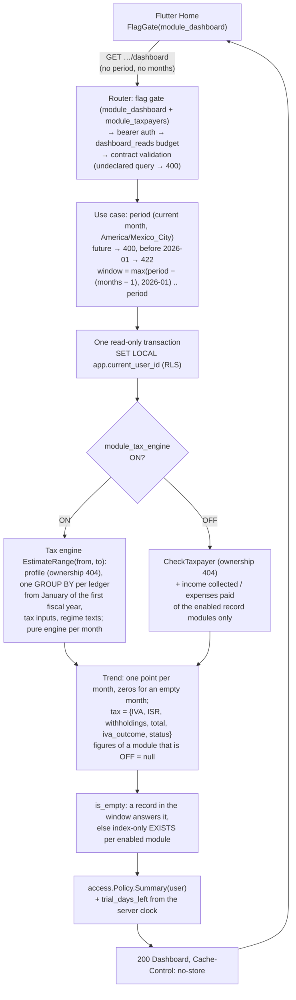

# Module M6: Dashboard

| | |
|---|---|
| Flag | `module_dashboard` (OFF by default; requires `module_taxpayers`. `module_tax_engine`, `module_incomes` and `module_expenses` are **not** prerequisites: each one OFF removes its part of Home) |
| Spec | [MODULE-dashboard.md](../project-specs/MODULE-dashboard.md) |
| Contract | [`docs/api/openapi.yaml`](../api/openapi.yaml), tag `Dashboard`, `x-module: module_dashboard` (frozen by M6-01 in 0.8.0) |
| Gates | [M6-07 tech lead](../reviews/M6-07-tech-lead-gate.md) PASS, [M6-08 security](../reviews/M6-08-security-gate.md) PASS, [M6-06 QA](../reviews/M6-06-qa.md) (Android) |
| Operations | [Dashboard runbook](../runbooks/dashboard.md) |
| Code | `backend/internal/dashboard/` (`domain`, `usecase`, `adapter/http`), `backend/cmd/api/dashboard.go` (adapters over the tax engine, the ledgers, the taxpayers profile and `access.Policy`), `mobile/lib/features/dashboard/`. M6 owns **no tables** and **no tax math** |

## What Home shows

Home is the first screen after sign-in. For the **active taxpayer** (the one picked in the
header; never an archived one) it answers three questions, read-only: how much will I probably
pay this month, how is this month going, and how has the year gone. The app renders the server's
figures as they are; it never adds, re-rounds or recomputes them.

One operation feeds the whole screen:

| Operation | Endpoint | Read-only user |
|---|---|---|
| `getDashboard` | `GET /v1/taxpayers/{taxpayerId}/dashboard?period=YYYY-MM&months=6..12` (both optional; the app sends neither) | allowed (no `402`) |

Sections, in reading order (MODULE-dashboard §6), and the field each one is drawn from:

| # | Section | From | Shown when |
|---|---|---|---|
| 1 | **Access banner**: "Prueba gratuita: quedan {d} días · {i} ingresos y {g} gastos", or "Modo lectura: …" | `access` | `access` is `trial` or `read_only`; `pro` and `comp` show nothing |
| 2 | **Strong CPA banner** (non-dismissible) | `estimate.disclaimers[]` with severity `strong` | the engine is ON and a rule is pending CPA review |
| 3 | **Hero**: Total a pagar, ISR, IVA or "Saldo a favor", Retenciones a enterar (when non-zero), "Vence el …", one status chip for the taxpayer; tapping it (or "Ver detalle") opens the estimate screen for the same month | `estimate` (the same `TaxpayerEstimate` as `getTaxpayerEstimate`) | the engine is ON and the taxpayer holds a regime this month. No regime → the M2 `NoRegimePrompt` instead |
| 4 | **Legend** "Esto es un aproximado. No todos los gastos aplican para tu giro comercial." directly under every tax figure | `legend` | present if and only if `estimate` is |
| 5 | **Month card**: "Ingresos cobrados", "Gastos pagados" (before IVA) and their "Diferencia" | `month` | at least one of the two figures is not `null` |
| 6 | **Trend**: "Últimos N meses", two views in a segmented control, **Impuestos** (stacked IVA / ISR / withholdings, ▲ on an incomplete or partial month) and **Ingresos y gastos**; "Ver como tabla" switches to the text alternative | `trend[]` | at least one view has data (below) |
| 7 | **Quick actions** "Registrar ingreso" / "Registrar gasto": the M3/M4 create pages for the active taxpayer; Home refreshes on return | flags | each one while its module is ON |

A taxpayer with no live record (`is_empty: true`) gets the **empty state** in place of 3–6:
"Aún no hay ingresos ni gastos registrados. El estimado aparece con el primer registro.", with
both quick actions. No `$0.00` hero. The access banner still shows.

Home's figures and the estimate screen's are the same numbers to the centavo (contract test
`TestContract_dashboard`; walked on a device in [M6-06 §3](../reviews/M6-06-qa.md#3-home-vs-what-was-entered-dana-october-2026)).
What Home deliberately leaves to the estimate screen (M5-25): the period picker, the per-regime
cards, the breakdown, the `warning` / `info` disclaimers and the tax-inputs form.

## How a Home is built



- **One aggregate pass.** The engine's `EstimateRange` reads each ledger **once** for the whole
  window, even across two fiscal years, then runs the pure engine month by month (about 1.1 ms
  for 10 months and 3 regimes). `EstimateMonth` is `EstimateRange(p, p)[0]`, so the hero and the
  estimate screen cannot disagree.
- **Income vs expense come from the same rows** the estimator reads: income **collected**
  (`collected_on`) and expenses **paid** (`paid_on`), live records only, before IVA, deductible
  or not. An income invoiced but not collected is not on Home. Records in informational regimes
  count here (they are real money) but never in a tax figure.
- **Taxpayer status** per month, server-side, with the M5 precedence: `informational` (every
  regime informational) > `incomplete` > `partial` > `complete`; `none` when no regime is held
  that month.
- **Saldo a favor** never makes a negative bar: `iva_payable_rounded_cents = 0` and
  `iva_outcome = in_favor`.
- **No partial answers.** If any read fails, the request fails (`500`) and the app shows the error
  state with "Reintentar". A failed pull to refresh also shows the error, never the previous
  figures as if they were fresh (M6-07 G2). No figure is cached on the device.

### Try it locally

These requests were run on 2026-10-14 (and again on 2026-10-15 with contract 0.12.0, same output) against `make -C backend api` with the `demo_core` preset
on an isolated local stack. Get `ACCESS` from the [M1 walkthrough](auth.md#try-it-locally)
(steps 1 to 5).

```sh
API=http://localhost:3000
AUTH="Authorization: Bearer $ACCESS"

# 0. A física with 612 since January 2026.
TAXPAYER_ID=$(curl -s -X POST "$API/v1/taxpayers" -H "$AUTH" -H 'Content-Type: application/json' -d '{
  "person_type": "fisica", "rfc": "GOMA800101AB6", "display_name": "Ana (honorarios)",
  "regimes": [{"regime_code": "612", "start_period": "2026-01"}]}' | jq -r .id)
HOME_URL="$API/v1/taxpayers/$TAXPAYER_ID/dashboard"

# 1. No records yet: the empty state, the trial banner's figures, no tax figure to show.
curl -s "$HOME_URL" -H "$AUTH" | jq -c '{is_empty, month, points: (.trend | length), access}'

# 2. Two incomes collected (January, March) and one expense paid (March), 16 % IVA, from personas físicas.
record() { # $1 incomes|expenses, $2 date, $3 amount
  local body
  if [ "$1" = incomes ]; then
    body='{id: $id, regime_code: "612", counterparty_kind: "pf_with_activity", amount_cents: $amt,
           iva_rate: "rate_16", iva_cents: ($amt * 16 / 100), collected_on: $on}'
  else
    body='{id: $id, regime_code: "612", category_code: "papeleria", amount_cents: $amt, iva_rate: "rate_16",
           iva_cents: ($amt * 16 / 100), payment_method: "transfer", has_cfdi: true, paid_on: $on}'
  fi
  curl -s -o /dev/null -w '%{http_code} ' -X POST "$API/v1/taxpayers/$TAXPAYER_ID/$1" -H "$AUTH" \
    -H 'Content-Type: application/json' -d "$(jq -nc --arg id "$(uuidgen | tr 'A-Z' 'a-z')" \
    --arg on "$2" --argjson amt "$3" "$body")"
}
record incomes 2026-01-15 2000000; record incomes 2026-03-10 1500000; record expenses 2026-03-20 300000; echo

# 3. March as the period: the month's figures, the hero estimate and the trend (oldest first).
curl -s "$HOME_URL?period=2026-03" -H "$AUTH" | jq -c '{period, is_empty, month,
  hero: {total: .estimate.totals.total_payable_rounded_cents, due_date: .estimate.due_date}, legend}'
curl -s "$HOME_URL?period=2026-03" -H "$AUTH" \
  | jq -r '.trend[] | "\(.period) in=\(.income_cents) out=\(.expense_cents) tax=\(.tax.total_payable_rounded_cents) \(.tax.iva_outcome) \(.tax.status)"'

# 4. The default window: the current month and up to 11 before it, never before 2026-01.
curl -s "$HOME_URL" -H "$AUTH" | jq -c '{period, first: .trend[0].period, points: (.trend | length)}'
curl -s "$HOME_URL?months=6" -H "$AUTH" | jq -c '{first: .trend[0].period, points: (.trend | length)}'

# 5. Refusals: before 2026, a future month, months outside 6..12, an undeclared parameter.
for q in period=2025-12 period=2099-01 months=13 foo=1; do
  curl -s "$HOME_URL?$q" -H "$AUTH" \
    | jq -c --arg q "$q" '{q: $q, code: .error.code, details: [.error.details[] | {field, code}]}'
done

# 6. Another user's taxpayer, or a random id: the same 404 as module_dashboard OFF.
curl -s -o /dev/null -w '%{http_code}\n' "$API/v1/taxpayers/$(uuidgen | tr 'A-Z' 'a-z')/dashboard" -H "$AUTH"

# 7. Engine OFF degrades Home: no estimate, no tax per month, no legend; the figures stay.
make -C backend flags ARGS="disable module_tax_engine"; sleep 6   # the flag cache TTL is 5 s
curl -s "$HOME_URL?period=2026-03" -H "$AUTH" \
  | jq -c '{estimate, legend: has("legend"), month, taxes: [.trend[].tax] | unique}'

# 8. Incomes OFF as well: its figures are null, never 0.
make -C backend flags ARGS="disable module_incomes"; sleep 6
curl -s "$HOME_URL?period=2026-03" -H "$AUTH" | jq -c '{month, incomes: [.trend[].income_cents] | unique}'

# 9. Dashboard OFF: the hidden 404. Then back to demo_core.
make -C backend flags ARGS="disable module_dashboard"; sleep 6
curl -s "$HOME_URL" -H "$AUTH" | jq -c '{code: .error.code, message: .error.message}'
make -C backend flags ARGS="apply-preset demo_core"
```

Output, in order (the `make … flags` tables left out; `trial_ends_at` is sign-up + 168 h):

```text
{"is_empty":true,"month":{"income_cents":0,"expense_cents":0},"points":10,"access":{"access":"trial","trial_ends_at":"2026-10-21T23:22:56Z","trial_days_left":7,"incomes_remaining":5,"expenses_remaining":5}}
201 201 201
{"period":"2026-03","is_empty":false,"month":{"income_cents":1500000,"expense_cents":300000},"hero":{"total":432465,"due_date":"2026-04-17"},"legend":"Esto es un aproximado. No todos los gastos aplican para tu giro comercial."}
2026-01 in=2000000 out=0 tax=558365 payable complete
2026-02 in=0 out=0 tax=145803 zero incomplete
2026-03 in=1500000 out=300000 tax=432465 payable incomplete
{"period":"2026-10","first":"2026-01","points":10}
{"first":"2026-05","points":6}
{"q":"period=2025-12","code":"business_rule_violation","details":[{"field":"period","code":"parameters_unavailable"}]}
{"q":"period=2099-01","code":"validation_failed","details":[{"field":"period","code":"out_of_range"}]}
{"q":"months=13","code":"validation_failed","details":[{"field":"months","code":"maximum"}]}
{"q":"foo=1","code":"validation_failed","details":[{"field":"foo","code":"additionalProperties"}]}
404
{"estimate":null,"legend":false,"month":{"income_cents":1500000,"expense_cents":300000},"taxes":[null]}
{"month":{"income_cents":null,"expense_cents":300000},"incomes":[null]}
{"code":"not_found","message":"Not found."}
```

Reading it: in October 2026 the default window is January..October, 10 points, because nothing
exists before 2026-01. February has no record but still has a tax figure: 612 ISR is year to
date, so January's income carries into February, and both February and March are `incomplete`
because the prior provisional payments were not entered (they are computed as zero; the hero's
chip says "Incompleto" and links to the estimate screen). January's 5,583.65 is the same figure
the M6-06 QA walk saw for the same income. The walkthrough uses 2 of the user's 5 trial incomes
and 1 of the 5 trial expenses.

## Flag behaviour (`module_dashboard`)

- OFF (the default): `getDashboard` answers `404 not_found` (`no-store`), indistinguishable from a
  foreign taxpayer, and the app keeps the previous placeholder Home with its flag-gated buttons.
  Inicio stays in the bottom bar.
- **Prerequisite `module_taxpayers`** (`flags.Prerequisites`; the route lives under a taxpayer):
  with it OFF the dashboard is hidden too, whatever its own flag says, and absent from
  `GET /v1/flags`. `make -C backend flags` lists it as `hidden` with `REQUIRES module_taxpayers`.
- **The other modules degrade Home; they do not hide it.** The server does not compute what a
  disabled module owns, so nothing of it leaves the server. The app hides each section from the
  response's `null`s alone:

| OFF | Response | Home |
|---|---|---|
| `module_tax_engine` | `estimate: null`, every `trend[].tax: null`, no `legend`; the estimator and tax inputs are not read | No CPA banner, hero or legend; the trend has only "Ingresos y gastos", without the view switcher; the table has no IVA/ISR/total |
| `module_incomes` | `month.income_cents` and every `trend[].income_cents` are `null` (never `0`) | No "Ingresos cobrados", no income series, no "Diferencia", no "Registrar ingreso". Tax figures are unchanged: the engine reads incomes either way (MODULE-incomes OQ-8) |
| `module_expenses` | the same for `expense_cents` | The same for expenses and "Registrar gasto" |
| both record modules | both figures `null` everywhere; `is_empty: false` (it counts only enabled modules) | No month card, no "Ingresos y gastos" view, no empty state |
| engine and both record modules | no figure at all | Only the access banner |
| `module_subscriptions` | — | The banner's "Ver planes" is hidden |

- A running API sees a change within 5 s.
- Suites: `backend/adapter/http/gen/dashboard_module_test.go` (the operation's flag),
  `backend/internal/platform/flags/prerequisites_test.go`, `backend/cmd/api/dashboard_preset_smoke_integration_test.go`
  (every seeded preset plus the no-dashboard, no-engine, no-record-modules and no-taxpayers
  fixtures), `TestContract_dashboardFlagMatrix` (the 8 engine × incomes × expenses combinations
  against PostgreSQL), `mobile/test/features/dashboard/dashboard_flag_test.dart`.
- Member of `demo_core`, `demo_monetization` and `demo_full`.
- **Do not enable it in staging or production** until every precondition of the
  [security gate §5](../reviews/M6-08-security-gate.md#5-preconditions-to-enable-module_dashboard-in-staging-or-production)
  holds, the manual TalkBack/VoiceOver pass (P-5) and the staging p95 (P-8) included.

```sh
make -C backend flags ARGS="apply-preset demo_core"     # auth, taxpayers, incomes, expenses, tax engine, dashboard
make -C backend flags ARGS="enable module_dashboard"    # needs module_taxpayers ON to take effect
make -C backend flags ARGS="disable module_dashboard"
```

## Access summary and the trial banner

`access` is the caller's `AccessSummary`, the frozen shape M7 reuses (the pre-wizard access
check too). It is derived from the user id in the token and the **server** clock only; no header
or parameter changes it (M6-08 §1).

| Field | `trial` | `read_only` | `pro` / `comp` |
|---|---|---|---|
| `access` | `trial` | `read_only` | `pro` / `comp` |
| `trial_ends_at` | sign-up + 168 h | `null` | `null` |
| `trial_days_left` | whole days left, rounded **up**, at least 1 while the trial runs (OQ-D6) | `null` | `null` |
| `incomes_remaining`, `expenses_remaining` | 5 minus records created, per user across **all** taxpayers | `0` | `null` |

Deleting a record never gives a trial slot back, so the counters do not rise after a delete; the
banner's screen-reader label says the counts are shared by all the user's taxpayers. A read-only
user keeps every figure (PRD §7); the quick actions stay visible and open the paywall, and the
server answers `402` to the create regardless.

## Performance

Measured in PR #114 (M6-03) by `TestPerf_dashboardReadPath`: one user, one taxpayer with 3
regimes (612, 606, 625), 50,000 incomes + 50,000 expenses over 2026-01..2027-06, five times the
PRD's 10,000 records a year, the default window spanning **two fiscal years**, end to end through
the router (authentication, flag gate, budget, use case, JSON) on a local Docker PostgreSQL:

| `getDashboard` | n | p50 | **p95** | p99 |
|---|---|---|---|---|
| sequential | 300 | 91.6 ms | **98.2 ms** | 110.9 ms |
| concurrent, 4 workers | 200 | 98.3 ms | **103.4 ms** | 104.4 ms |

- The budget is **p95 < 1 s** (the test fails above it); the internal goal is ≤ 300 ms. Re-run on
  2026-10-14 for these docs, on a laptop running other stacks: p95 228.6 ms sequential, 128.3 ms
  concurrent, PASS.
- **8 read statements per request, whatever `months` is**: profile (taxpayer + regimes, 2), one
  aggregate per ledger (2), the tax inputs of both fiscal years (1), regime texts (1), access
  (entitlements + usage, 2); plus up to 2 index-only `EXISTS` when the window has no record.
  PR #114's description still counts 9 (one tax-inputs statement per year); the merged code reads
  both years in one statement, and `TestContract_dashboardStatementCount` pins 8 in the regular integration suite for a 6- and a
  12-month window. Why 8 and not the spec's 6 is in [MODULE-dashboard §2.4](../project-specs/MODULE-dashboard.md#24-one-aggregate-pass-performance).
- EXPLAIN ANALYZE as `cc_app` under RLS: income aggregate 24.9 ms, expense aggregate 11.3 ms;
  everything else is an index scan under 0.1 ms. `BenchmarkEstimateRange` (10 months, 3 regimes):
  1.1 ms/op.
- The security gate's own probe of a built binary (M6-08, 100k rows, one cold first call of
  5.7 s, then): p95 220 ms sequential, 433 ms with 8 concurrent clients. The cold start is why
  staging p95 is a precondition (REL-06 k6).

```sh
cd backend
CC_PERF=1 go test -tags=integration -count=1 -run TestPerf_dashboardReadPath -v ./cmd/api/   # needs Docker; seeds 100k rows
go test -tags=integration -count=1 -run TestContract_dashboardStatementCount ./cmd/api/
```

Per-user budget `dashboard_reads` (ADR-0005): **600 per hour, burst 600**, one more every 6 s;
spent → `429 rate_limited` with `Retry-After`. It is separate from `estimate_reads`: the range
estimate inside the dashboard does not spend the estimate screen's budget. Budgets fail closed,
so a limiter outage turns Home into `429` (alert on `rate limit unavailable`).

## Accessibility

- **Spoken summary.** The chart is one screen-reader node labelled with what the screen shows,
  for example "Impuestos estimados, últimos 10 meses. Octubre: 4,181 pesos con 66 centavos,
  incompleto. Mes más alto: enero, 5,583 pesos con 65 centavos." The "Ingresos y gastos" view
  states both series for the month and the window totals. With the engine OFF the summary
  mentions no tax.
- **Bars.** Under the summary, one node per month, oldest first, with the month, every series,
  the total and the status in words ("febrero de 2026: IVA 3,100 pesos, ISR 400 pesos, total
  3,500 pesos, incompleto"), the button role, the selected state and a **tap action**, so a
  screen-reader user can select a month (M6-07 G1). Targets are at least 44 × 44 px.
- **Data-table alternative.** "Ver como tabla" replaces the chart with the same data from the
  same response: one block per month, a heading ("febrero de 2026, Incompleto") and one sentence
  per figure in column order (Ingresos cobrados, Gastos pagados, IVA, ISR, Retenciones, Total,
  Estado), with the legend under it. A block per month instead of an 8-column grid, so it wraps
  at 200 % text on a phone; for a screen reader it is equivalent.
- Colour is never the only carrier: the key has text labels, ▲ has "Mes incompleto o parcial",
  saldo a favor is said in words. Marks ≥ 3:1, chart text ≥ 4.5:1 and the 44 px targets are
  checked by widget tests in both themes. The chart does not animate. Home is tested at 200 % text;
  the table and "Ingresos y gastos" views are not yet (a #113 nit, in the follow-ups).
- Pinned by `mobile/test/features/dashboard/dashboard_semantics_test.dart` (the semantics tree
  itself, not label matching) and `dashboard_home_test.dart`. **Still owed:** a manual TalkBack
  pass on a real Android device and VoiceOver on iOS (M6-07 FU6, security precondition P-5).

## Errors

Every error uses the single envelope `ErrorResponse`. `details[].code` carries the rule
(`out_of_range` for a future `period`, `parameters_unavailable` before 2026-01, `minimum` /
`maximum` for `months`, `additionalProperties` for an undeclared query parameter). Amounts are
never echoed in an error, and the dashboard logs nothing on success or on a `4xx`; a `500` logs
the error chain, which carries periods, counts and sentinels, never an amount. Every response,
errors included, carries `Cache-Control: no-store`.

The table below is **generated from the contract** by `make api-error-tables`; do not edit
it by hand. CI (`make api-error-tables-check`) fails when it differs from `openapi.yaml`.

<!-- BEGIN GENERATED error-table module_dashboard -->
| Operation | Endpoint | HTTP | `error.code` | When |
|---|---|---|---|---|
| `getDashboard` | `GET /v1/taxpayers/{taxpayerId}/dashboard` | 400 | `validation_failed` | Input does not match the contract (malformed `period` or path id, `months` not an integer in 6..12, unknown query parameter), or a future `period` (`out_of_range`). |
| `getDashboard` | `GET /v1/taxpayers/{taxpayerId}/dashboard` | 401 | `unauthorized` | Missing, invalid or expired credentials. |
| `getDashboard` | `GET /v1/taxpayers/{taxpayerId}/dashboard` | 404 | `not_found` | The taxpayer does not exist or belongs to another user, or `module_dashboard` (or `module_taxpayers`) is disabled, which answers `404` before any input check, a malformed request included (indistinguishable on purpose). With the module ON a malformed id is `400`. |
| `getDashboard` | `GET /v1/taxpayers/{taxpayerId}/dashboard` | 422 | `business_rule_violation` | `period` is before 2026-01, the first month any record or estimate can exist (`parameters_unavailable`). A well-formed request with nothing to show, hence `422`, as `getTaxpayerEstimate`. |
| `getDashboard` | `GET /v1/taxpayers/{taxpayerId}/dashboard` | 429 | `rate_limited` | Rate limit exceeded. |
| `getDashboard` | `GET /v1/taxpayers/{taxpayerId}/dashboard` | 500 | `internal_error` | Unexpected server error. |
<!-- END GENERATED error-table module_dashboard -->

## Decisions

Full text in [MODULE-dashboard §11](../project-specs/MODULE-dashboard.md#11-open-questions-defaults-apply-unless-the-owner-says-otherwise);
each one is checked against the contract, the backend and the app in the
[M6-07 gate](../reviews/M6-07-tech-lead-gate.md#spec--contract-080--code-module-dashboard-oq-d1d7).

| # | Decision | Effect |
|---|---|---|
| OQ-D1 | 12-month trend (the design direction showed 6) | `months` 6..12, default 12; the window never starts before 2026-01 |
| OQ-D2 | Home's income is **collected**, not invoiced | "Ingresos cobrados" = `collected_on` in the month, before IVA |
| OQ-D3 | A record module that is OFF is hidden on Home | Its figures are `null` and not computed; the app hides figure, series and quick action |
| OQ-D4 | Withholdings to remit are a third bar segment | Only when a month has some |
| OQ-D5 | Own rate budget | `dashboard_reads` 600/h, separate from `estimate_reads` |
| OQ-D6 | Trial days left from the server clock | `trial_days_left`; the app never uses the device clock |
| OQ-D7 | Engine OFF degrades Home instead of hiding it | Income/expense only; amends MODULE-tax-engine §7 / US-X4 |

## API reference

```sh
make api-docs                 # build/api-docs/index.html, rendered from docs/api/openapi.yaml
make api-error-tables         # regenerate the error table on this page after a contract change
```

## Known limits

The deferred items are in the [PLAN M6 follow-ups](../project-specs/PLAN-control-contable.md#m6-follow-ups),
the [security gate §4](../reviews/M6-08-security-gate.md#4-consolidated-m6-follow-ups) and the
[tech-lead gate](../reviews/M6-07-tech-lead-gate.md#follow-ups). The ones a user or an operator
can notice:

- Every tax figure on Home is the M5 estimate, so it carries M5's limits: **no rule is
  CPA-verified yet** (M5-33), and the engine must not be ON for real users until it is.
- The table says "IVA: saldo a favor" without the amount: the contract's `TrendTax` has no
  in-favor figure (QA D-3, contract 0.8.x).
- With one record module OFF, the view is still titled "Ingresos y gastos" (QA D-2); a one-month
  window reads "Últimos 1 meses" (FU2, only reachable with `period=2026-01`).
- The first request after an API start-up at 100k rows took 5.7 s on a laptop (cold cache and
  plans); staging p95 is not measured yet (REL-06).
- No "all my taxpayers" view, period picker, cache or offline figures in v1.
