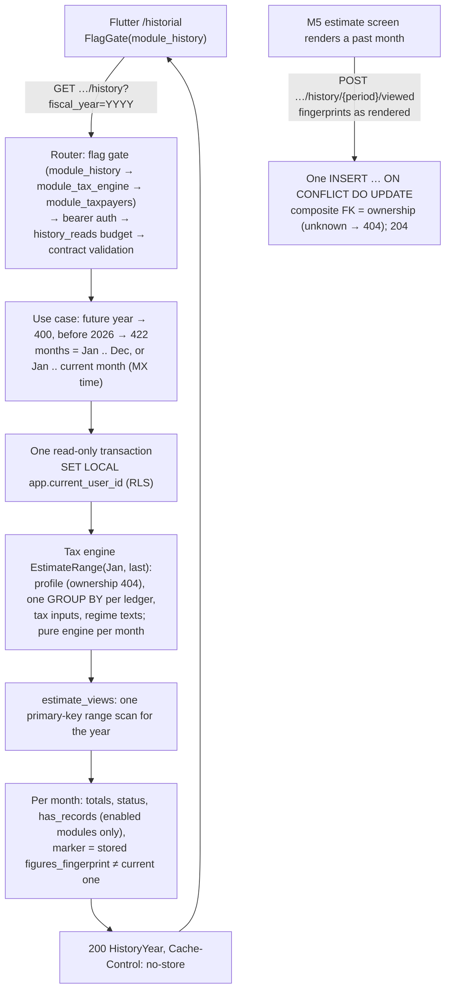

# Module M8: History

| | |
|---|---|
| Flag | `module_history` (OFF by default; requires `module_tax_engine`, and through it `module_taxpayers`. `module_incomes` / `module_expenses` are **not** prerequisites) |
| Spec | [MODULE-history.md](../project-specs/MODULE-history.md) |
| Contract | [`docs/api/openapi.yaml`](../api/openapi.yaml), tag `History`, `x-module: module_history` (frozen by M8-01 in 0.9.0; `TaxpayerEstimate.figures_fingerprint` required since 0.11.1, M8-03) |
| Design | [ADR-0002 Amendment 2](../adr/0002-tax-engine.md) (`FiguresFingerprint`, scheme `figures/1`) |
| Gates | M8-08 tech lead **PASS** and M8-09 security **PASS** (both recorded on [PR #149](https://github.com/romodevx/control-contable/pull/149)); [M8-07 QA](../../.gstack/qa-reports/qa-report-history-2026-10-14.md) pass at the automated level, **device walk owed** |
| Code | `backend/internal/history/` (`domain`, `usecase`, `adapter/http`, `infra`), `backend/cmd/api/history.go` (adapter over the tax engine's `EstimateRange`), `backend/migrations/20261014180000_estimate_views.sql`, `mobile/lib/features/history/`. M8 owns **one table** (`estimate_views`) and **no tax math** |

## What History shows

For the **active taxpayer**, History answers one question: what did the app estimate for each
month of this fiscal year, and did anything change since I last looked? It is read-only. Every
figure is recalculated from the current records on each read; History stores only *what the user
saw*, never a tax figure (ADR-0002 §5).

The entry is the **"Historial"** button in Home's app bar (`/historial`), shown only while
`module_history` is effectively ON. It works on the dashboard Home and on the placeholder Home
(dashboard OFF).

| Part | What the user sees |
|---|---|
| **Ejercicio fiscal** picker | 2026 .. the current year (America/Mexico_City); defaults to the current year |
| **Strong CPA banner** | Non-dismissible, when any month has a rule pending CPA review |
| **Suma de estimados mensuales** | ISR, IVA, withholdings and total summed over the listed months, with "No es la declaración anual." A saldo a favor never subtracts from it |
| **Legend** | The server's "Esto es un aproximado…" text, then warnings, then notes |
| **Months, newest first** | January .. December for a past year; January .. the current month for the current one. One row per month, never a hole |

Each month row, one tappable target read as one sentence:

- Month name, the **total a pagar** (right-aligned), the status chip and the due date.
- `ISR {isr} · IVA {iva}`, or `ISR {isr} · IVA: saldo a favor {iva}`; "Retenciones a enterar"
  when non-zero.
- "Mes en curso" on the current month; "Sin régimen en este mes" (no amounts) before the first
  regime or in a month without one; "Sin registros en este mes" when no enabled record module has
  a record that month.
- The **changed marker** or "Visto el {date}" (next section).
- "Ver ingresos" / "Ver gastos": open the M3/M4 list on that month, each behind its own flag. A
  navigation aid, not a reconciliation: the lists select by booking date, the estimate by
  collected / paid / invoiced date.

Tapping a row opens the **M5 estimate screen** for that period (`/estimado?periodo=YYYY-MM`); its
regime cards lead to the breakdown. History is read again on return, and the row's new state is
announced politely. The app never recomputes or re-rounds a figure: each month's totals equal the
estimate screen's for the same period to the centavo (`TestContract_history`,
`TestHistoryQA_noFalseMarks`).

Other states: skeleton while loading (also on a taxpayer switch, never the previous taxpayer's
figures), "No se pudo cargar el historial." with "Reintentar", "Registre un contribuyente para ver
su historial.", and the empty year "Aún no hay registros. El historial se llena con su primer
ingreso o gasto." with "Registrar ingreso" (when `module_incomes` is ON). The empty state needs
**no records and no figure** on every month, so a year whose records are hidden by a record module
being OFF still shows its tax figures (M8-08 F1).

## The "Cambió desde que lo viste" marker

A month is marked when the **figures the user saw** have moved since the user last opened it. The
marker is driven only by `figures_fingerprint` (OQ-H4): a SHA-256 over the canonical text of the
displayed figures (totals, due date, each regime's key, status, ISR, IVA, withholdings and CPA
flag; scheme `figures/1`, golden-pinned). Versions, texts, explanations, citations and breakdown
order are not in it, so a record edit or an engine bump that leaves the numbers identical marks
nothing.

| Month | Shows | `changed_since_viewed` / `change_reason` |
|---|---|---|
| Never opened | nothing (OQ-H1: no "new" badges on first use) | `false` / `null` |
| Opened, figures unchanged | "Visto el 14 feb" | `false` / `null` |
| Opened, figures moved, engine version or parameter set differs | "Cambió desde que lo viste: se corrigió el cálculo." | `true` / `engine` (wins when both apply) |
| Opened, figures moved otherwise | "Cambió desde que lo viste: agregaste o cambiaste registros o datos fiscales." | `true` / `records` |
| Current month | "Mes en curso", never marked (OQ-H3) | `false` / `null` |

- The marker is text plus an icon, never colour alone.
- **YTD regimes** (612, 601, 626 PM) are cumulative: a late January income legitimately marks
  every viewed month from January on. That is correct, not noise.
- A record that is added and then deleted again restores the fingerprint, so the mark clears
  without opening the month.
- **Opening clears it.** When the estimate screen renders a **past** month successfully, the app
  posts `markHistoryViewed` with the `records_fingerprint`, `figures_fingerprint`,
  `engine_version` and `parameter_set` of the estimate it rendered, verbatim. This happens from
  **any** entry point while the flag is ON (OQ-H7): a History row, Home's "Ver detalle", or the
  estimate screen's own month picker. The post is fire-and-forget: a failure is logged without the
  fingerprints and retried on the next open; it never blocks the screen.
- Storing what the user saw (not a recompute at POST time) keeps the marker honest if records
  change between render and post. A forged body can only mislead the caller's own marker (RLS);
  it is never trusted for any figure.
- A change of the fingerprint **scheme** would mark every viewed month; it needs an ADR-0002
  amendment and a one-time re-baseline of stored views in the same migration.
- Operations that move many past figures at once (an `EngineVersion` bump, the
  [withholdings backfill](../runbooks/withholdings-backfill.md)) mark the affected viewed months
  with reason `engine` or `records`; that is the intended signal.

## How a History is built



- **One aggregate pass.** `getHistory` runs one `EstimateRange` for the year's months and one
  `estimate_views` range scan: **7 read statements**, whatever the month count, pinned by
  `TestContract_historyStatementCount` (`histPerfReads`). Never 12 × `EstimateMonth`.
- **No false marks.** History's range estimate and the single-month estimate the app posts hash
  the same on every month, `none` months and the WH-09 cross-month IVA credit included, for a
  persona física and a persona moral (`TestHistoryQA_noFalseMarks`, M8-07). If they ever diverged,
  opening a month would mark it at once.
- `markHistoryViewed` stores the server clock as `viewed_at`, accepts the current month (stored,
  never marked), and is idempotent: the last view wins.

### `estimate_views`

| Column | Notes |
|---|---|
| `user_id`, `taxpayer_id`, `period` | Primary key; `period` is the first day of the month. Composite FK `(user_id, taxpayer_id)` → `taxpayers`, `ON DELETE CASCADE` |
| `records_fingerprint`, `figures_fingerprint` | `char(64)`, lower-case hex (DB `CHECK` and domain check) |
| `engine_version`, `parameter_set` | ≤ 32 characters, as seen |
| `viewed_at` | Server clock |

- **Per user**, not per taxpayer: if delegated access ever exists, each person keeps their own
  "seen" state.
- RLS `ENABLE` + `FORCE`, one policy per operation on `app.current_user_id`; `cc_app` has no
  `UPDATE` on the key columns and no `DELETE`. Isolation tests: `history/infra`
  `TestViewStore_isolation`.
- No amount is ever stored. Rows survive the flag being OFF and cascade on taxpayer or account
  deletion; turning the flag back on resumes the markers.

## Flag behaviour (`module_history`)

- OFF (the default): `getHistory` and `markHistoryViewed` answer `404 not_found`, before any input
  check, indistinguishable from an unknown taxpayer. The app hides "Historial", `/historial` does
  not open, and the estimate screen never posts a view (it still works).
- **Prerequisite `module_tax_engine`** (`flags.Prerequisites`), and through it `module_taxpayers`:
  with either OFF, History is hidden whatever its own flag says, absent from `GET /v1/flags`, and
  `make -C backend flags` lists it as `hidden` with its `REQUIRES` column. History without
  estimates has nothing to show (closes PLAN D7).
- `module_incomes` / `module_expenses` OFF: figures are unaffected (the engine reads the records
  either way); only that module's "Ver …" link hides and `has_records` counts only the enabled
  modules.
- A running API sees a change within 5 s.
- **Presets:** member of `demo_full` only; `demo_core` and `demo_monetization` leave it out
  (OQ-H6).
- Suites: `backend/adapter/http/gen/history_module_test.go`,
  `backend/cmd/api/history_preset_smoke_integration_test.go` (every seeded preset plus the
  history-only, no-engine and no-taxpayers fixtures), `TestContract_historyFlagMatrix`,
  `mobile/test/features/history/history_flag_test.dart` (dashboard and placeholder Home),
  `history_viewed_test.dart`.

```sh
make -C backend flags ARGS="apply-preset demo_full"     # every module, History included
make -C backend flags ARGS="enable module_history"      # needs module_tax_engine and module_taxpayers ON to take effect
make -C backend flags ARGS="disable module_history"
```

## Access, budgets and performance

- Open to **read-only** users and **archived** taxpayers: reading and marking create no record,
  so there is no `402` and no trial cap.
- Per-user budgets (ADR-0005), separate from `estimate_reads`: `history_reads` **600/h, burst 600**
  for `getHistory`; `history_views` **1,200/h, burst 120** for `markHistoryViewed`. Spent →
  `429 rate_limited` with `Retry-After`. Budgets fail closed.
- Every response, errors included, carries `Cache-Control: no-store`. The app keeps History only
  in memory (auto-dispose providers), with no disk or HTTP cache.
- Measured in PR #132 by `TestPerf_historyReadPath` (50k incomes + 50k expenses in 2026, 3
  regimes, 12 viewed months, end to end through the router on a local Docker PostgreSQL):

| Path | n | p50 | **p95** |
|---|---|---|---|
| `getHistory` sequential | 300 | 91 ms | **96 ms** |
| `getHistory` concurrent, 4 workers | 200 | 99.6 ms | **105 ms** |
| baseline: 12 × `getTaxpayerEstimate` | 10 | 579 ms | 604 ms |

  The budget is p95 < 1 s (internal goal ≤ 300 ms). Not re-run for these docs: Docker was down
  on 2026-10-14. Staging p95 is REL-06 (k6).

```sh
cd backend
CC_PERF=1 go test -tags=integration -count=1 -run TestPerf_historyReadPath -v ./cmd/api/   # needs Docker; seeds 100k rows
go test -tags=integration -count=1 -run TestContract_historyStatementCount ./cmd/api/
```

## Accessibility

- Each month row is one focusable target (≥ 44 × 44 px) read in order: month, total, status,
  marker ("Marzo 2026. Total a pagar 2,284 pesos 29 centavos. Incompleto. Cambió desde que lo
  viste."). "Ver ingresos" / "Ver gastos" are separate targets with the month in their label.
- Text plus icon for the marker and the status; saldo a favor in words. Contrast and target
  guidelines pass in light and dark; the screen survives 200 % text (amounts wrap under the month).
- The return from a month is announced with `SemanticsService.sendAnnouncement` (VoiceOver-safe),
  not a live region.
- **Still owed:** the manual TalkBack pass on the month rows (reading order, focus return to the
  row after pop, the announcement) and VoiceOver on iOS (OB6).

## Errors

Every error uses the single envelope `ErrorResponse`. `details[].code` carries the rule
(`out_of_range` for a future `fiscal_year` / `period`, `parameters_unavailable` before 2026).
Amounts, fingerprints and submitted values are never echoed in an error, and only a `5xx` cause
is logged (a test asserts no fingerprint or amount reaches the logs).

The table below is **generated from the contract** by `make api-error-tables`; do not edit
it by hand. CI (`make api-error-tables-check`) fails when it differs from `openapi.yaml`.

<!-- BEGIN GENERATED error-table module_history -->
| Operation | Endpoint | HTTP | `error.code` | When |
|---|---|---|---|---|
| `getHistory` | `GET /v1/taxpayers/{taxpayerId}/history` | 400 | `validation_failed` | Input does not match the contract (malformed `fiscal_year` or path id, unknown query parameter), or a `fiscal_year` after the current one (`out_of_range`). |
| `getHistory` | `GET /v1/taxpayers/{taxpayerId}/history` | 401 | `unauthorized` | Missing, invalid or expired credentials. |
| `getHistory` | `GET /v1/taxpayers/{taxpayerId}/history` | 404 | `not_found` | The taxpayer does not exist or belongs to another user, or `module_history` is effectively OFF (`module_history`, `module_tax_engine` or `module_taxpayers` disabled), which answers `404` before any input check, a malformed request included (indistinguishable on purpose). With the module ON a malformed id is `400`. |
| `getHistory` | `GET /v1/taxpayers/{taxpayerId}/history` | 422 | `business_rule_violation` | `fiscal_year` is before 2026, the first fiscal year with published tax parameters (`parameters_unavailable`). A well-formed request with nothing to show, hence `422`, as `getTaxpayerEstimate`. |
| `getHistory` | `GET /v1/taxpayers/{taxpayerId}/history` | 429 | `rate_limited` | Rate limit exceeded. |
| `getHistory` | `GET /v1/taxpayers/{taxpayerId}/history` | 500 | `internal_error` | Unexpected server error. |
| `markHistoryViewed` | `POST /v1/taxpayers/{taxpayerId}/history/{period}/viewed` | 400 | `validation_failed` | Input does not match the contract (malformed `period` or path id; missing, malformed or unknown body field, e.g. a fingerprint that is not 64 lower-case hex characters), or a future `period` (`out_of_range`). |
| `markHistoryViewed` | `POST /v1/taxpayers/{taxpayerId}/history/{period}/viewed` | 401 | `unauthorized` | Missing, invalid or expired credentials. |
| `markHistoryViewed` | `POST /v1/taxpayers/{taxpayerId}/history/{period}/viewed` | 404 | `not_found` | The taxpayer does not exist or belongs to another user, or `module_history` is effectively OFF (`module_history`, `module_tax_engine` or `module_taxpayers` disabled), which answers `404` before any input check, a malformed request included (indistinguishable on purpose). With the module ON a malformed id is `400`. |
| `markHistoryViewed` | `POST /v1/taxpayers/{taxpayerId}/history/{period}/viewed` | 422 | `business_rule_violation` | `period` is before 2026-01, the first month any estimate can exist (`parameters_unavailable`). |
| `markHistoryViewed` | `POST /v1/taxpayers/{taxpayerId}/history/{period}/viewed` | 429 | `rate_limited` | Rate limit exceeded. |
| `markHistoryViewed` | `POST /v1/taxpayers/{taxpayerId}/history/{period}/viewed` | 500 | `internal_error` | Unexpected server error. |
<!-- END GENERATED error-table module_history -->

## Decisions

Full text in [MODULE-history §11](../project-specs/MODULE-history.md#11-decisions-coordinator-2026-10-14--all-decided).

| # | Decision | Effect |
|---|---|---|
| OQ-H1 | Never-viewed months are not "new" | Only a viewed month can be marked |
| OQ-H2 | No old → new amount in v1 | The marker says *that* it changed, not by how much (needs stored amounts; later Could) |
| OQ-H3 | The current month is never marked | "Mes en curso" |
| OQ-H4 | Mark only when the displayed figures change | `figures_fingerprint`; `engine` / `records` only explains the cause |
| OQ-H5 | Newest first | Matches the M3/M4 lists |
| OQ-H6 | Presets | `demo_full` only |
| OQ-H7 | Mark from any entry point | History row, Home "Ver detalle", the estimate screen's picker |

## Gates

| Gate | Verdict | Notes |
|---|---|---|
| M8-07 QA ([report](../../.gstack/qa-reports/qa-report-history-2026-10-14.md)) | Pass at the automated level, no app defect | Backend unit, integration, contract and RLS suites (CI, real PostgreSQL); 1,368 mobile tests; the client against the Prism mock. Added the first persona moral coverage and the range vs single-month hash parity test. **Device walk blocked** (Docker down, no local PostgreSQL) |
| M8-08 tech lead | **PASS** | Canon checklist clean. One finding fixed test-first on #149: F1, a record module OFF hid the whole year behind the empty state |
| M8-09 security | **PASS**, no fixes | RLS + column grants, composite FK ownership, hidden `404`, format checks with no echo, own budgets, no fingerprints or amounts in logs, no client cache |

**Enable in a shared environment** only after both gates (done) **and** the owed device walk
below, plus the engine's own preconditions: History shows M5 figures, and `module_tax_engine`
stays OFF in shared environments until the
[M5-31 preconditions](../reviews/M5-31-security-gate.md#5-preconditions-to-enable-module_tax_engine-in-staging-or-production)
hold, first the CPA sign-off (M5-33).

## API reference

The operations, schemas and examples live only in the contract; render them instead of copying
them here:

```sh
make api-docs                 # build/api-docs/index.html, rendered from docs/api/openapi.yaml (tag History)
make api-error-tables         # regenerate the error table on this page after a contract change
make mock                     # Prism mock of the contract, for the app without a backend
```

## Known limits and follow-ups

Tracked in the [PLAN M8 follow-ups](../project-specs/PLAN-control-contable.md#m8-follow-ups).
The ones a user or an operator can notice:

- **Device walk done** (2026-10-15, M8-07 report §7) on Android against a native PostgreSQL. It
  fixed two stale screens: History's empty state did not re-read after "Registrar ingreso", and Home
  did not re-read on return from History. Still owed: the TalkBack pass with real gestures (focus
  return to the row after a pop could not be driven through adb) and iOS (OB6).
- **Undo from another screen leaves it stale** (M8-07 F3): the delete toast's *Deshacer* outlives
  the route, so restoring while History or Home is on top restores the record, but that screen
  keeps its marks until it is pulled down. Fixing it needs an app-wide "records changed" signal.
- Every figure is the M5 estimate, so it carries M5's limits: **no rule is CPA-verified yet**
  (M5-33).
- A very fast return can re-read History before the fire-and-forget upsert lands; the
  announcement then reads the old state and the row updates silently on the next read (rare;
  watch for it in the device walk).
- The estimate screen marks on provider transitions only: a future caller that pre-warms
  `estimateProvider` would stop marking. No current route does.
- `none` months are tappable and open an estimate screen with nothing to show: consistent, low
  value.
- No year comparison, export, all-taxpayers history, push on change (M9) or annual return; the
  annual estimate is its own module ([annual](annual.md)).
