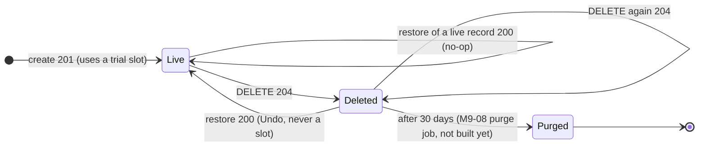

# Module M3: Incomes

| | |
|---|---|
| Flag | `module_incomes` (OFF by default; requires `module_taxpayers`) |
| Spec | [MODULE-incomes.md](../project-specs/MODULE-incomes.md) |
| Contract | [`docs/api/openapi.yaml`](../api/openapi.yaml), tag `Incomes`, `x-module: module_incomes` (frozen by M3-01 in 0.5.0, amended in 0.6.0 and 0.6.1; withholdings derived since 0.9.0, typed amounts and `counterparty_type` removed in 0.12.0, [ADR-0008](../adr/0008-withholdings-are-derived.md)) |
| Gates | [M3-12 tech lead](../reviews/M3-M4-tech-lead-gate.md) PASS, [M3-13 security](../reviews/M3-M4-security-gate.md) PASS, [M3-11 QA](../reviews/M3-M4-QA.md) |
| Operations | [Incomes and expenses runbook](../runbooks/incomes-expenses.md) |
| Code | `backend/internal/incomes/` (domain, usecase, infra, adapter), `backend/internal/kernel/fiscal/` (shared with M4), `backend/cmd/api/incomes.go`, `records.go`, `ledger_incomes.go`, `backend/migrations/20261013200000_incomes.sql`, `mobile/lib/features/incomes/`, `mobile/lib/core/records/` |

## What it does

The user records what the **active taxpayer** earned, as read from the CFDI or the bank
statement: amount before IVA, IVA, who paid and for what, and the dates. The server derives
the withholdings the payer made from those facts ([withholdings](withholdings.md)).
Each income belongs to one taxpayer and one regime that taxpayer holds on the income's dates.
M3 stores facts and never computes a tax: the tax engine (M5) reads the incomes through the
ledger reader (M3-07). Expenses are the sibling module, [M4](expenses.md); both share the
record mechanics on this page (idempotency, soft delete and Undo, trial cap).

The API reference for each operation is generated from the contract (`make api-docs`, see
[API reference](#api-reference)). This page covers how the operations fit together.

| Operation | Endpoint | Read-only user |
|---|---|---|
| `listIncomes` | `GET /v1/taxpayers/{taxpayerId}/incomes?period=YYYY-MM&regime=&cursor=&limit=` | allowed |
| `createIncome` | `POST /v1/taxpayers/{taxpayerId}/incomes` | `402` |
| `getIncomeDefaults` | `GET /v1/taxpayers/{taxpayerId}/incomes/defaults?regime=&on=&platform_activity=` | allowed |
| `previewIncomeWithholdings` | `GET /v1/taxpayers/{taxpayerId}/incomes/withholding-preview?…` (the form's derived card; stores nothing) | allowed |
| `getIncome` | `GET /v1/taxpayers/{taxpayerId}/incomes/{incomeId}` | allowed |
| `updateIncome` | `PATCH /v1/taxpayers/{taxpayerId}/incomes/{incomeId}` (merge-patch) | `402` |
| `deleteIncome` | `DELETE /v1/taxpayers/{taxpayerId}/incomes/{incomeId}` (soft) | allowed |
| `restoreIncome` | `POST /v1/taxpayers/{taxpayerId}/incomes/{incomeId}/restore` (Undo) | allowed |

Every operation needs a bearer token. A taxpayer or income id that belongs to another user
answers `404 not_found`, the same as one that does not exist. Money is `int64` MXN centavos
everywhere (`1000000` is $10,000.00); there is no currency field.

## Record lifecycle

One diagram for both record kinds: an expense follows the same states (M4 reuses M3 §2.3 and
§2.7).



| Step | Rules |
|---|---|
| **Create** | The client sends its own `id`; see [Idempotent client ids](#idempotent-client-ids). Order of checks, in one transaction: schema (`400`) → idempotency (`200`/`409`) → read-only access (`402`) → regime window and archive (`422`) → domain rules (`400`/`422`) → trial slot (`402`) → insert. A failed insert gives the slot back |
| **Edit** | `PATCH` is merge-patch on top-level fields: an absent field is unchanged, `null` clears a nullable one (`cfdi_uuid`, `description`, `invoiced_on`, `collected_on`). Every rule re-runs on the result, including the regime window when a date or `regime_code` changes. Last write wins (no ETag in v1) |
| **Delete** | Soft: sets `deleted_at`. The income leaves the list, the totals, the ledger reader and the regime-end check at once. Deleting twice is `204`. `GET` of a deleted income is `404` |
| **Restore (Undo)** | Clears `deleted_at` after re-checking the regime window: if the regime was ended before the income's dates in the meantime, `422 regime_not_active`. It **never consumes a trial slot** and runs no access check, so it works at 5/5 and for a read-only user |
| **Purge** | 30 days after the delete, the M9-08 job (not built yet) removes the row; afterwards restore answers `404`. Until it ships, deleted rows stay restorable |
| **Archived taxpayer** | Reads work; create, edit, delete and restore answer `422 business_rule_violation`, detail `taxpayer_archived`. Archive freezes the data (OQ-5) |

The app shows the delete as a toast "Ingreso eliminado · Deshacer" that does not
auto-dismiss; several deletes stack into one toast, and a partial failure says how many came
back ("Se restauró 1 de 2 ingresos."). The toast is cleared on sign-out.

## Booking date: cash vs accrual

Which date an income counts on is catalog data, `regimes.income_basis`, not a switch in code.
The **booking date** (`booked_on`) is the ISR date: it decides the list month and the
estimate month. The database derives it on every write (trigger `incomes_derive_booked_on`);
clients cannot send it (see the [runbook §3](../runbooks/incomes-expenses.md#3-derived-columns-clients-cannot-set)).

| Basis | Regimes | Required date | ISR date (`booked_on`) | IVA date |
|---|---|---|---|---|
| cash | every persona física regime, 626 PM, 603, 610 | `collected_on` | `collected_on` | `collected_on` |
| accrual | personas morales of Título II: 601, 620, 622, 623, 624 | `invoiced_on` | `invoiced_on` | `collected_on` (LIVA 1-B: IVA is always cash) |

- An accrual income with `collected_on = null` is **"Por cobrar"** (`pending_collection: true`):
  it counts for ISR in its invoice month, and for IVA only once the user sets `collected_on`.
- Either date may precede the other (an advance is collected before the invoice).
- Omitting the required date answers `400` (`collected_on` or `invoiced_on` / `required`).

### Date limits

| Date | Answer |
|---|---|
| After today (America/Mexico_City) | `400 validation_failed`, `out_of_range` on that date |
| **Before 2026-01-01** | `400 validation_failed`, `out_of_range` on that date: the first tax parameter set is 2026, so no rate can be checked on an earlier date |
| Outside the regime's `[start_period, end_period]` | `422 business_rule_violation`, `regime_code` / `regime_not_active`. The regime window is checked **before** the parameters, so a 2025 date in a regime that starts in 2026 answers `422`, not `400` |
| In a year whose parameters are not published yet | Accepted with the warning `provisional_parameters` on that date |

2022-01-01 is only the database CHECK backstop. The estimates answer a month before 2026
differently, `422 parameters_unavailable`: there the month is a well-formed period the engine
has no parameters for, while a record date the server cannot validate is invalid input
(contract 0.7.0, `BusinessDate`).

## IVA

| `iva_rate` | `iva_cents` must be |
|---|---|
| `rate_16`, `rate_8` | within **±100 centavos** of `round(amount_cents × rate)` (`IvaTolerance`, OQ-3). CFDIs compute IVA per line, so totals drift a few centavos |
| `rate_0`, `exempt` | `0` |

- Outside the tolerance: `422`, `iva_cents` / `iva_amount_mismatch`. It is a check, not a
  rounding the server stores: the stored value is what the user typed.
- The rate must be allowed on the **IVA date** (`collected_on`, or `invoiced_on` for an accrual
  income still pending collection), as served by the rate catalog. `rate_8` (border region) is a
  user declaration and is allowed while the decree runs; after its end date the answer is
  `422`, `iva_rate` / `rate_not_valid_on_date`. No date is hard-coded in the app or the API.
- `getIncomeDefaults` returns `iva_rates_allowed` and `suggested_iva_rate` (`rate_16`) for the
  date `on`; the app never keeps its own list.

## Withholdings received (retenciones)

Since contract 0.12.0 the user never types a withholding. The income carries the facts the CFDI
would show, and the server derives the ISR and IVA the payer withheld, on create, edit, restore
and in the preview:

| Field | Question in the form |
|---|---|
| `counterparty_kind` (required) | "¿A quién le facturaste?": `pm`, `pf_with_activity`, `pf_no_activity_or_public`, `gov_federal`, `gov_state_municipal`, `foreign` |
| `operation_kind` | "¿Qué le vendiste o qué servicio diste?"; omitted → the last value used in the regime, else the regime default |
| `residential_rent` | Housing rent; `true` requires `iva_rate: exempt` (`422 residential_rent_exempt`) |
| `via_platform` | Collected through a platform (625 and personas morales) |

- The result is the read-only `withholding` object (rates, rule ids, explanations,
  `table_version`); `isr_withheld_cents` / `iva_withheld_cents` stay as read-only mirrors the
  ledger reads. Sending either of them answers `400 validation_failed`,
  `additionalProperties`.
- `getIncomeDefaults` serves `last_used`, the facts to preselect for the regime.
- The decision table, the warnings and what `withholding: null` means for an income stored
  before derivation are on the [withholdings page](withholdings.md).
- 625 needs `platform_activity`, one of the taxpayer's 625 activities (`422
  activity_not_held` otherwise). It defaults to the only activity when there is one; with
  several and none sent, `400 required`. On any other regime it is `400 not_for_regime`.

## Warnings

Never errors: the record is saved and `warnings[]` explains. Codes are append-only; the app
shows the `message` of a code it does not know. Warnings are computed per write, not stored.

| Code | Field | When |
|---|---|---|
| `duplicate_cfdi_uuid` | `cfdi_uuid` | Another live income of the same taxpayer has the folio. Legit for partial collections (OQ-9) |
| `withholding_cpa_unverified` | `withholding` | A derivation rule pending CPA review matched ([withholdings](withholdings.md#what-is-stored-and-served)) |
| `foreign_counterparty_not_supported` | `counterparty_kind` | Billed abroad: derived zero |
| `withholding_differs_from_rate` | — | Retired with typed amounts (0.12.0); never emitted, kept in the append-only enum |
| `provisional_parameters` | `collected_on` / `invoiced_on` | The rates on that date come from a provisional parameter set |

## Trial cap and access

The trial gives **5 incomes per user**, across all their taxpayers, independent of the 5
expenses. The slot is taken atomically in the create transaction (`UPDATE user_usage … WHERE
incomes_created < 5`), so concurrent creates never overshoot.

| Operation | Trial with slots | Trial at 5/5 | Read-only (no trial, no plan) | pro / comp |
|---|---|---|---|---|
| list, get, defaults | ✓ | ✓ | ✓ | ✓ |
| create | ✓ (uses a slot) | `402`, `incomes_remaining` / `trial_cap_reached` | `402` (no details) | ✓ |
| idempotent create retry | `200` (no slot) | `200` | `200` | `200` |
| edit | ✓ | ✓ | `402` | ✓ |
| delete | ✓ | ✓ | ✓ | ✓ |
| restore (Undo) | ✓ (no slot) | ✓ (no slot) | ✓ (no slot) | ✓ |

- **Deleting never frees a slot.** The counter only goes up (a database trigger refuses a
  decrease), so delete + create at 5/5 is still `402`.
- **Restore never consumes a slot** (OQ-10): the slot was taken once, at creation, and the
  record never left the count.
- A refused 6th income leaves the expense slots untouched.
- Write budget: 300 income mutations per user per hour, then `429` with `Retry-After`
  (scope `income_writes`, separate from expenses).

## Idempotent client ids

The form generates the `id` (UUIDv7 recommended) once per form session and resends it on
every retry; "Guardar y crear otro" starts a new session with a new `id`. The server
generates one when none is sent. The lookup runs **before** the access check:

| The `id` … | Answer | Slot used |
|---|---|---|
| is new | `201` | yes |
| is the caller's, same taxpayer, live, same fields after normalization | `200` with the stored income | no |
| is the caller's with other fields, another taxpayer, or a deleted income | `409 conflict`, `id` / `id_reused` | no |
| belongs to another user | `409 conflict`, no `details` (reveals no owner) | no |

A retry at 5/5, or by a user who just turned read-only, therefore gets `200`, never `402`.
Ids are per table: an income id reused as an expense id is a new expense.

### Try it locally

These requests were run against `make -C backend api` with `module_auth`, `module_taxpayers`
and `module_incomes` ON. Get `ACCESS` from the [M1 walkthrough](auth.md#try-it-locally)
(steps 1 to 5).

```sh
API=http://localhost:3000
AUTH="Authorization: Bearer $ACCESS"

# 0. A física with 612 since 2026-01, the earliest start (records before a regime's start_period answer 422).
TAXPAYER_ID=$(curl -s -X POST "$API/v1/taxpayers" -H "$AUTH" -H 'Content-Type: application/json' -d '{
  "person_type": "fisica", "rfc": "GOMA800101AB6", "display_name": "Ana (honorarios)",
  "regimes": [{"regime_code": "612", "start_period": "2026-01"}]}' | jq -r .id)

# 1. Form prefill for a 612 income: IVA rates, and the facts last used in this regime (none yet).
curl -s "$API/v1/taxpayers/$TAXPAYER_ID/incomes/defaults?regime=612&on=2026-10-05" \
  -H "$AUTH" | jq -c .

# 2. Create with a client id: 201. 10,000.00 + IVA 1,600.00 of fees billed to a company;
#    the server derives ISR 10 % and IVA 2/3 withheld.
INCOME_ID=$(uuidgen | tr 'A-Z' 'a-z')
INCOME=$(jq -nc --arg id "$INCOME_ID" '{id: $id, regime_code: "612", counterparty_kind: "pm",
  operation_kind: "professional_services", amount_cents: 1000000, iva_rate: "rate_16",
  iva_cents: 160000, collected_on: "2026-10-05"}')
curl -s -X POST "$API/v1/taxpayers/$TAXPAYER_ID/incomes" -H "$AUTH" \
  -H 'Content-Type: application/json' -d "$INCOME" | jq -c .withholding

# 3. Same id and body again (a lost response, a double tap): 200, no second record, no slot.
curl -s -o /dev/null -w '%{http_code}\n' -X POST "$API/v1/taxpayers/$TAXPAYER_ID/incomes" -H "$AUTH" \
  -H 'Content-Type: application/json' -d "$INCOME"

# 4. Same id, another amount: 409 conflict, id / id_reused.
curl -s -X POST "$API/v1/taxpayers/$TAXPAYER_ID/incomes" -H "$AUTH" -H 'Content-Type: application/json' \
  -d "$(echo "$INCOME" | jq -c '.amount_cents = 2000000 | .iva_cents = 320000')" \
  | jq -c '{code: .error.code, details: [.error.details[] | {field, code}]}'

# 5. A date before 2026: the regime window is checked first, so 422 regime_code / regime_not_active.
curl -s -X POST "$API/v1/taxpayers/$TAXPAYER_ID/incomes" -H "$AUTH" -H 'Content-Type: application/json' \
  -d "$(echo "$INCOME" | jq -c 'del(.id) | .collected_on = "2025-12-31"')" \
  | jq -c '{code: .error.code, details: [.error.details[] | {field, code}]}'

# 6. The month: items by booking date, totals of the whole filtered month.
curl -s "$API/v1/taxpayers/$TAXPAYER_ID/incomes?period=2026-10&regime=612" -H "$AUTH" \
  | jq -c '{items: (.items | length), totals}'

# 7. Delete (soft): 204. Undo (restore): 200, no trial slot.
curl -s -o /dev/null -w '%{http_code}\n' -X DELETE "$API/v1/taxpayers/$TAXPAYER_ID/incomes/$INCOME_ID" -H "$AUTH"
curl -s -o /dev/null -w '%{http_code}\n' -X POST "$API/v1/taxpayers/$TAXPAYER_ID/incomes/$INCOME_ID/restore" -H "$AUTH"
```

Output, in order (run again on 2026-10-15 against contract 0.12.0):

```text
{"iva_rates_allowed":["rate_16","rate_8","rate_0","exempt"],"last_used":{"counterparty_kind":null,"operation_kind":"professional_services","residential_rent":false,"via_platform":false},"platform_activity":null,"suggested_iva_rate":"rate_16"}
{"cpa_unverified":false,"explanations":[{"rule_id":"ISR-5","text":"La empresa te retiene 10 % de ISR por honorarios (LISR art. 106)."},{"rule_id":"IVA-6","text":"Y 2/3 del IVA por servicios de persona física (LIVA art. 1-A, RLIVA art. 3)."}],"isr_cents":100000,"isr_rate":"0.1","iva_basis":"two_thirds_of_iva","iva_cents":106667,"net_cents":953333,"remit_due_on":null,"rule_ids":["ISR-5","IVA-6"],"table_version":"2026.1","withholder":"counterparty"}
200
{"code":"conflict","details":[{"field":"id","code":"id_reused"}]}
{"code":"business_rule_violation","details":[{"field":"regime_code","code":"regime_not_active"}]}
{"items":1,"totals":{"amount_cents":1000000,"count":1,"isr_withheld_cents":100000,"iva_cents":160000,"iva_withheld_cents":106667}}
204
200
```

The walkthrough uses one of the user's 5 trial incomes (step 2 only). The expense side
continues in the [M4 walkthrough](expenses.md#try-it-locally) with the same `TAXPAYER_ID`.

## List

- `period` (required, `YYYY-MM`) selects incomes whose **booking date** is in the month;
  `regime` filters by regime.
- Keyset pagination on `(booked_on DESC, id DESC)`: `limit` 50 by default, 100 at most;
  `next_cursor` is opaque and `null` on the last page.
- `totals` cover the whole filtered month, not just the page: count, amount, IVA, ISR and IVA
  withheld.

## Flag behaviour (`module_incomes`)

- OFF (the default): all 8 operations, `defaults` and `withholding-preview` included, answer `404 not_found` with the
  standard error envelope. The app shows no Ingresos tab and no "Registrar ingreso" on Home.
- **Prerequisite `module_taxpayers`** (`flags.Prerequisites`): with `module_taxpayers` OFF,
  incomes are hidden too, whatever their own flag says. `GET /v1/flags` omits the module and
  `make -C backend flags` lists it as `hidden` with `REQUIRES module_taxpayers`.
- Independent of `module_expenses`: either can be ON alone.
- Hidden data still exists: with the flag OFF, ending a regime still counts the incomes, account
  and taxpayer deletion still cascade, and the M5 estimate still reads them (OQ-8: flags hide
  screens, not data; own data only).
- A running API sees a change within 5 s.
- Suites: `backend/adapter/http/gen/records_module_test.go` (the 8 operations, by operationId
  and route), `backend/cmd/api/records_preset_smoke_integration_test.go` (every preset and the
  prerequisite fixtures, all 16 record operations probed),
  `mobile/test/features/incomes/*_flag_test.dart`.
- Member of `demo_core`, `demo_monetization` and `demo_full`.
- **Do not enable it in staging or production** until every precondition in
  [runbook §5](../runbooks/incomes-expenses.md#5-enable-module_incomes-and-module_expenses-in-a-shared-environment) holds.

```sh
make -C backend flags ARGS="enable module_incomes"    # needs module_taxpayers ON to take effect
make -C backend flags ARGS="disable module_incomes"
```

## Errors

Every error uses the single envelope `ErrorResponse`. `error.code` is the stable value to
branch on; `details[].field` names the body field or parameter and `details[].code` the domain
rule (`regime_not_active`, `iva_amount_mismatch`, `trial_cap_reached`, ...; see each operation
in the contract). Amounts, descriptions and CFDI folios are never echoed in an error.

Every response, record body or error, carries `Cache-Control: no-store` (contract 0.7.0,
written once by the API's edge middleware; security gate G-1).

The table below is **generated from the contract** by `make api-error-tables`; do not edit
it by hand. CI (`make api-error-tables-check`) fails when it differs from `openapi.yaml`.

<!-- BEGIN GENERATED error-table module_incomes -->
| Operation | Endpoint | HTTP | `error.code` | When |
|---|---|---|---|---|
| `listIncomes` | `GET /v1/taxpayers/{taxpayerId}/incomes` | 400 | `validation_failed` | Input does not match the contract (query parameter, path or body). |
| `listIncomes` | `GET /v1/taxpayers/{taxpayerId}/incomes` | 401 | `unauthorized` | Missing, invalid or expired credentials. |
| `listIncomes` | `GET /v1/taxpayers/{taxpayerId}/incomes` | 404 | `not_found` | The taxpayer or record does not exist, belongs to another user, is deleted or purged, its id is malformed, or the module is disabled (indistinguishable on purpose). |
| `listIncomes` | `GET /v1/taxpayers/{taxpayerId}/incomes` | 429 | `rate_limited` | Rate limit exceeded. |
| `listIncomes` | `GET /v1/taxpayers/{taxpayerId}/incomes` | 500 | `internal_error` | Unexpected server error. |
| `createIncome` | `POST /v1/taxpayers/{taxpayerId}/incomes` | 400 | `validation_failed` | Input does not match the contract, or a date, activity or amount rule (`details[].code`: see the operation description). |
| `createIncome` | `POST /v1/taxpayers/{taxpayerId}/incomes` | 401 | `unauthorized` | Missing, invalid or expired credentials. |
| `createIncome` | `POST /v1/taxpayers/{taxpayerId}/incomes` | 402 | `entitlement_required` | Read-only access (trial over, no active plan), or the income trial cap is spent: `details[0]` names the cap (`incomes_remaining` / `trial_cap_reached`). Never on an idempotent retry. |
| `createIncome` | `POST /v1/taxpayers/{taxpayerId}/incomes` | 404 | `not_found` | The taxpayer or record does not exist, belongs to another user, is deleted or purged, its id is malformed, or the module is disabled (indistinguishable on purpose). |
| `createIncome` | `POST /v1/taxpayers/{taxpayerId}/incomes` | 409 | `conflict` | The client `id` is reused: by the caller with other fields, another taxpayer or a deleted income (`details`: `id` / `id_reused`), or it belongs to another user (no `details`). |
| `createIncome` | `POST /v1/taxpayers/{taxpayerId}/incomes` | 422 | `business_rule_violation` | Well-formed but violates an income rule: regime window, archived taxpayer, IVA rate or amount, withholdings, 625 activity (`details[].code`: see `createIncome`). `withholding_not_applicable` and `withholding_exceeds_base` are retired by WH-06 (no typed amount is left to check; never sent since 0.11.3); `residential_rent_exempt` is new in 0.10.0. |
| `createIncome` | `POST /v1/taxpayers/{taxpayerId}/incomes` | 429 | `rate_limited` | Rate limit exceeded. |
| `createIncome` | `POST /v1/taxpayers/{taxpayerId}/incomes` | 500 | `internal_error` | Unexpected server error. |
| `getIncomeDefaults` | `GET /v1/taxpayers/{taxpayerId}/incomes/defaults` | 400 | `validation_failed` | Input does not match the contract: `on` out of range (`out_of_range`, 2026-01-01 … today), or `platform_activity` for a regime other than 625 (`not_for_regime`). |
| `getIncomeDefaults` | `GET /v1/taxpayers/{taxpayerId}/incomes/defaults` | 401 | `unauthorized` | Missing, invalid or expired credentials. |
| `getIncomeDefaults` | `GET /v1/taxpayers/{taxpayerId}/incomes/defaults` | 404 | `not_found` | The taxpayer or record does not exist, belongs to another user, is deleted or purged, its id is malformed, or the module is disabled (indistinguishable on purpose). |
| `getIncomeDefaults` | `GET /v1/taxpayers/{taxpayerId}/incomes/defaults` | 422 | `business_rule_violation` | The regime is not held on `on`, or the 625 activity is not among the taxpayer's. |
| `getIncomeDefaults` | `GET /v1/taxpayers/{taxpayerId}/incomes/defaults` | 429 | `rate_limited` | Rate limit exceeded. |
| `getIncomeDefaults` | `GET /v1/taxpayers/{taxpayerId}/incomes/defaults` | 500 | `internal_error` | Unexpected server error. |
| `previewIncomeWithholdings` | `GET /v1/taxpayers/{taxpayerId}/incomes/withholding-preview` | 400 | `validation_failed` | Input does not match the contract: a missing or malformed parameter, `on` out of range (`out_of_range`), or a fact the regime cannot have (`not_for_regime`). |
| `previewIncomeWithholdings` | `GET /v1/taxpayers/{taxpayerId}/incomes/withholding-preview` | 401 | `unauthorized` | Missing, invalid or expired credentials. |
| `previewIncomeWithholdings` | `GET /v1/taxpayers/{taxpayerId}/incomes/withholding-preview` | 404 | `not_found` | The taxpayer or record does not exist, belongs to another user, is deleted or purged, its id is malformed, or the module is disabled (indistinguishable on purpose). |
| `previewIncomeWithholdings` | `GET /v1/taxpayers/{taxpayerId}/incomes/withholding-preview` | 422 | `business_rule_violation` | Well-formed but violates an income rule: regime window, archived taxpayer, IVA rate or amount, withholdings, 625 activity (`details[].code`: see `createIncome`). `withholding_not_applicable` and `withholding_exceeds_base` are retired by WH-06 (no typed amount is left to check; never sent since 0.11.3); `residential_rent_exempt` is new in 0.10.0. |
| `previewIncomeWithholdings` | `GET /v1/taxpayers/{taxpayerId}/incomes/withholding-preview` | 429 | `rate_limited` | Rate limit exceeded. |
| `previewIncomeWithholdings` | `GET /v1/taxpayers/{taxpayerId}/incomes/withholding-preview` | 500 | `internal_error` | Unexpected server error. |
| `getIncome` | `GET /v1/taxpayers/{taxpayerId}/incomes/{incomeId}` | 400 | `validation_failed` | Input does not match the contract (query parameter, path or body). |
| `getIncome` | `GET /v1/taxpayers/{taxpayerId}/incomes/{incomeId}` | 401 | `unauthorized` | Missing, invalid or expired credentials. |
| `getIncome` | `GET /v1/taxpayers/{taxpayerId}/incomes/{incomeId}` | 404 | `not_found` | The taxpayer or record does not exist, belongs to another user, is deleted or purged, its id is malformed, or the module is disabled (indistinguishable on purpose). |
| `getIncome` | `GET /v1/taxpayers/{taxpayerId}/incomes/{incomeId}` | 429 | `rate_limited` | Rate limit exceeded. |
| `getIncome` | `GET /v1/taxpayers/{taxpayerId}/incomes/{incomeId}` | 500 | `internal_error` | Unexpected server error. |
| `updateIncome` | `PATCH /v1/taxpayers/{taxpayerId}/incomes/{incomeId}` | 400 | `validation_failed` | Input does not match the contract, or a date, activity or amount rule (see `createIncome`). |
| `updateIncome` | `PATCH /v1/taxpayers/{taxpayerId}/incomes/{incomeId}` | 401 | `unauthorized` | Missing, invalid or expired credentials. |
| `updateIncome` | `PATCH /v1/taxpayers/{taxpayerId}/incomes/{incomeId}` | 402 | `entitlement_required` | Read-only access (trial over, no active plan). Never a trial-cap refusal. |
| `updateIncome` | `PATCH /v1/taxpayers/{taxpayerId}/incomes/{incomeId}` | 404 | `not_found` | The taxpayer or record does not exist, belongs to another user, is deleted or purged, its id is malformed, or the module is disabled (indistinguishable on purpose). |
| `updateIncome` | `PATCH /v1/taxpayers/{taxpayerId}/incomes/{incomeId}` | 422 | `business_rule_violation` | Well-formed but violates an income rule: regime window, archived taxpayer, IVA rate or amount, withholdings, 625 activity (`details[].code`: see `createIncome`). `withholding_not_applicable` and `withholding_exceeds_base` are retired by WH-06 (no typed amount is left to check; never sent since 0.11.3); `residential_rent_exempt` is new in 0.10.0. |
| `updateIncome` | `PATCH /v1/taxpayers/{taxpayerId}/incomes/{incomeId}` | 429 | `rate_limited` | Rate limit exceeded. |
| `updateIncome` | `PATCH /v1/taxpayers/{taxpayerId}/incomes/{incomeId}` | 500 | `internal_error` | Unexpected server error. |
| `deleteIncome` | `DELETE /v1/taxpayers/{taxpayerId}/incomes/{incomeId}` | 400 | `validation_failed` | Input does not match the contract (query parameter, path or body). |
| `deleteIncome` | `DELETE /v1/taxpayers/{taxpayerId}/incomes/{incomeId}` | 401 | `unauthorized` | Missing, invalid or expired credentials. |
| `deleteIncome` | `DELETE /v1/taxpayers/{taxpayerId}/incomes/{incomeId}` | 404 | `not_found` | The taxpayer or record does not exist, belongs to another user, is deleted or purged, its id is malformed, or the module is disabled (indistinguishable on purpose). |
| `deleteIncome` | `DELETE /v1/taxpayers/{taxpayerId}/incomes/{incomeId}` | 422 | `business_rule_violation` | The taxpayer is archived; archive freezes its records (OQ-5). |
| `deleteIncome` | `DELETE /v1/taxpayers/{taxpayerId}/incomes/{incomeId}` | 429 | `rate_limited` | Rate limit exceeded. |
| `deleteIncome` | `DELETE /v1/taxpayers/{taxpayerId}/incomes/{incomeId}` | 500 | `internal_error` | Unexpected server error. |
| `restoreIncome` | `POST /v1/taxpayers/{taxpayerId}/incomes/{incomeId}/restore` | 400 | `validation_failed` | Input does not match the contract (query parameter, path or body). |
| `restoreIncome` | `POST /v1/taxpayers/{taxpayerId}/incomes/{incomeId}/restore` | 401 | `unauthorized` | Missing, invalid or expired credentials. |
| `restoreIncome` | `POST /v1/taxpayers/{taxpayerId}/incomes/{incomeId}/restore` | 404 | `not_found` | The taxpayer or record does not exist, belongs to another user, is deleted or purged, its id is malformed, or the module is disabled (indistinguishable on purpose). |
| `restoreIncome` | `POST /v1/taxpayers/{taxpayerId}/incomes/{incomeId}/restore` | 422 | `business_rule_violation` | The regime no longer covers the record's dates (`regime_not_active`), or the taxpayer is archived (`taxpayer_archived`). |
| `restoreIncome` | `POST /v1/taxpayers/{taxpayerId}/incomes/{incomeId}/restore` | 429 | `rate_limited` | Rate limit exceeded. |
| `restoreIncome` | `POST /v1/taxpayers/{taxpayerId}/incomes/{incomeId}/restore` | 500 | `internal_error` | Unexpected server error. |
<!-- END GENERATED error-table module_incomes -->

## Decisions

Full text in [MODULE-incomes §10](../project-specs/MODULE-incomes.md#10-decisions-coordinator-2026-10-13--all-decided).

| # | Decision | Effect |
|---|---|---|
| OQ-1 | The form is its own page | 11 inputs; 5 visible at first, the rest under "Más detalles" |
| OQ-2 | The user types the subtotal | `amount_cents` is before IVA; the form shows the live total |
| OQ-3 | IVA tolerance ±100 centavos | `IvaTolerance` |
| OQ-4 | Incomes in informational regimes are allowed | The form says they do not change the estimate |
| OQ-5 | Delete and restore refused on an archived taxpayer | `422 taxpayer_archived` |
| OQ-6 | Undo toast never auto-dismisses; deletes stack | A "recently deleted" view is later |
| OQ-7 | `getIncomeDefaults` serves rates | No rate is hard-coded in the app |
| OQ-8 | M5 reads incomes even with `module_incomes` OFF | Flags hide screens, not data |
| OQ-9 | A duplicate CFDI folio is a warning | Partial collections are legit |
| OQ-10 | Restore never consumes a trial slot | Undo works at 5/5 |
| 0.6.1 | A read-only user may restore their own records | No `402` on restore |

## API reference

```sh
make api-docs                 # build/api-docs/index.html, rendered from docs/api/openapi.yaml
make api-error-tables         # regenerate the error table on this page after a contract change
```

## Known limits

The deferred items are in the [security gate §4](../reviews/M3-M4-security-gate.md#4-carried-m3m4-follow-ups),
the [tech-lead gate follow-ups](../reviews/M3-M4-tech-lead-gate.md#follow-ups-not-fixed-here) and the
[PLAN M3/M4 follow-ups](../project-specs/PLAN-control-contable.md#m3m4-follow-ups). The ones a user
or an operator can notice:

- The income basis of 620, 622 and 624, the booking-date rules and the withholding table are
  pending CPA review ([CPA-REVIEW.md](../reviews/CPA-REVIEW.md)); the estimate built on them is
  provisional until then.
- Onboarding starts every regime in the current month, so earlier incomes are refused with
  `422 regime_not_active` until the user edits the regime's start (QA D-9, M2 follow-up).
- The 8 % border rate is offered even when the regime's border option is off (QA D-5).
- CFDI XML import, foreign currency, credit notes and a "recently deleted" view are out of
  scope for v1.
