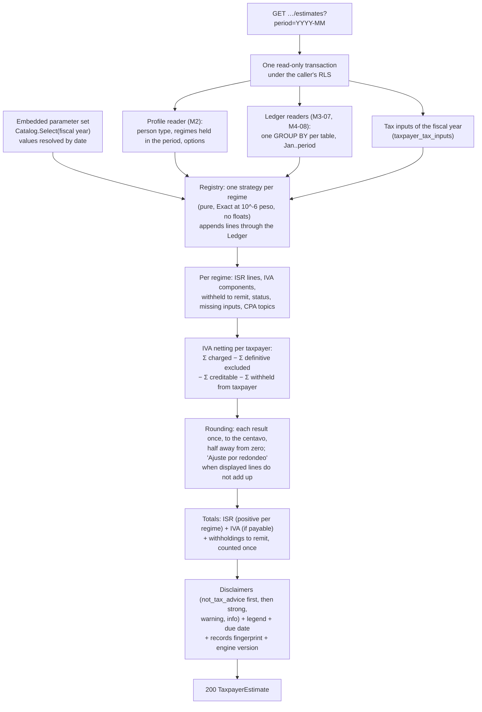

# Module M5: Tax engine

| | |
|---|---|
| Flag | `module_tax_engine` (OFF by default; requires `module_taxpayers`) |
| Spec | [MODULE-tax-engine.md](../project-specs/MODULE-tax-engine.md) |
| Design | [ADR-0002](../adr/0002-tax-engine.md) (strategies, versioned parameters, rounding, [engine version log](../adr/0002-tax-engine.md#engine-version-log)), [tax parameter schema](../architecture/tax-params-schema.md) |
| Contract | [`docs/api/openapi.yaml`](../api/openapi.yaml), tag `TaxEngine`, `x-module: module_tax_engine` (frozen by M5-01 in 0.6.0; `no-store` on every response since 0.7.0) |
| Gates | [M5-30 tech lead](../reviews/M5-30-tech-lead-gate.md) PASS, [M5-31 security](../reviews/M5-31-security-gate.md) PASS, [M5-29 QA](../reviews/M5-29-qa.md), [M5-06 parameter verification](../reviews/M5-06-params-verification.md). CPA sign-off (M5-33) **pending** |
| Guides | [Add a regime](../guides/add-a-regime.md), [December–January parameter update runbook](../runbooks/tax-params-update.md) |
| Code | `backend/internal/taxengine/` (`domain`, `domain/taxparams`, `params`, `usecase`, `infra`, `adapter/http`, `golden`, `strategies.go`), `backend/cmd/api/taxengine*.go`, `backend/migrations/20261014140000_regime_tax_input_kinds.sql`, `20261014141000_taxpayer_tax_inputs.sql`, `mobile/lib/features/tax_engine/` |

## What the estimate is, and what it is not

For one taxpayer and one month (`YYYY-MM`), the engine estimates what the user will owe on
the 17th of the next month: the provisional **ISR** of each regime, the monthly **IVA** of
the taxpayer (one figure for all its regimes), and the **withholdings to remit** (what a
persona moral withheld from its suppliers). Every figure comes with a breakdown whose lines
are the computation itself, each with its legal basis.

It is **informational**. It never files, never pays, never stores an estimate (each read
recomputes from the records), and it is not tax advice. Two texts travel with every estimate
and every breakdown, rendered by the server and shown by the app next to every figure:

- the **legend**, a contract `const`: "Esto es un aproximado. No todos los gastos aplican
  para tu giro comercial.";
- the **`not_tax_advice` disclaimer**, always first: "Estimación informativa. No sustituye la
  declaración ante el SAT ni la asesoría de un contador. Cálculo basado en LISR, LIVA, LIF
  2026 y Anexo 8 RMF 2026."

Rules a CPA has not validated still run, but they add the `cpa_review_pending` disclaimer
(severity `strong`: a non-dismissible banner above the figures) and mark each affected line
`needs_cpa_review`. Until M5-33 the module must not be enabled for real users
([security gate §5 P-1](../reviews/M5-31-security-gate.md#5-preconditions-to-enable-module_tax_engine-in-staging-or-production)).

| Operation | Endpoint | Read-only user |
|---|---|---|
| `getTaxpayerEstimate` | `GET /v1/taxpayers/{taxpayerId}/estimates?period=YYYY-MM` (`period` optional: the current month in America/Mexico_City) | allowed |
| `getEstimateBreakdown` | `GET /v1/taxpayers/{taxpayerId}/estimates/{period}/breakdown?regime=` | allowed |
| `getTaxInputs` | `GET /v1/taxpayers/{taxpayerId}/regimes/{regimeCode}/tax-inputs?fiscal_year=` | allowed |
| `putTaxInputs` | `PUT /v1/taxpayers/{taxpayerId}/regimes/{regimeCode}/tax-inputs?fiscal_year=` (replaces every value) | `402` |

Every operation needs a bearer token and answers with `Cache-Control: no-store`. Money is
`int64` MXN centavos; rates are decimal strings (`"0.1500"`). Periods go back to January 2026
(the first fiscal year with transcribed parameters) and never into the future.

## Regime coverage

Strategies are keyed by `(regime, person type)`. A regime without one falls back to the
informational strategy: its explanation, no amount.

| Regime | Person | Coverage | ISR | IVA |
|---|---|---|---|---|
| 612 Actividades empresariales y profesionales | PF | **full** | Year to date, cash basis, art. 106 accumulated tariff of the month | monthly |
| 606 Arrendamiento | PF | **full** (monthly payers) | Monthly, blind 35 % + predial or actual deductions, art. 96 tariff | monthly (residential rent exempt) |
| 626 RESICO | PF | **full** | Monthly, non-marginal bracket rate on cash income | monthly |
| 625 Plataformas Tecnológicas | PF | **full** with the definitive option and prior-year income ≤ $300,000; otherwise **partial** | Definitive: the platform's withholding is the ISR | monthly ⚠️ |
| 601 General de Ley Personas Morales | PM | **full** | Year to date, accrual: coeficiente de utilidad × income − PTU − losses, × 30 % | monthly, cash basis |
| 626 RESICO | PM | **full** | Year to date, cash profit × 30 % | monthly |
| 621 Incorporación Fiscal | PF | **partial** ⚠️ | Bimonthly, even months only, RIF reduction by year | bimonthly ⚠️ |
| 622 Actividades Agrícolas, Ganaderas, Silvícolas y Pesqueras | PM | **partial** | Not estimated (explained) | monthly |
| 603 Personas Morales con Fines no Lucrativos | PM | **partial** | Not estimated (explained) | monthly |
| 605, 607, 608, 610, 611, 614, 615, 616, 620, 623, 624 (and 606 quarterly payers) | PF / PM | **explanation only** | — | — |

The algorithms, their citations and the research worked examples behind each row are in
[MODULE-tax-engine §2.4](../project-specs/MODULE-tax-engine.md#24-regime-coverage-and-algorithms)
and §3. ⚠️ marks a rule that raises `cpa_review_pending`.

## Statuses

Each regime of the estimate (`RegimeEstimate.status`) has one status. When several apply, the
first in this table wins.

| Status | When | What the user sees |
|---|---|---|
| `informational` | No strategy, or the catalog marks the regime informational | The explanation, no amount |
| `incomplete` | A tax input this period needs is missing (for example a prior provisional payment) | The amount, computed with **zero** for each missing input, an "Incompleto" chip and the "Completa tus datos" button to the tax-inputs form, focused on the first missing key. `missing_inputs` lists `{key, label, months?}` |
| `partial` | The regime is only partly estimated (621, 622, 603, 625 without the definitive option) | The amount that is estimated, a "Parcial" chip and what is not estimated |
| `complete` | Everything the period needs is present | The amount |

A missing input is never an error. Which inputs are required depends on the period: no prior
payments in January, no coeficiente in a 601 first fiscal year, `prior_year_income` for 625
only with the definitive option.

## How a monthly estimate is computed



1. **Readers.** The use case reads, inside the request's RLS transaction, the taxpayer's
   profile, one pre-aggregated row per `(regime, month)` from incomes and from expenses for
   January to the period, the tax inputs of the fiscal year and the regime texts. It reads
   incomes and expenses even when their own flags are OFF (flags hide screens, not data).
2. **Strategies.** Each regime held in the period goes to its strategy with the parameter
   set of the period's fiscal year. A strategy is a pure function of its input and the
   parameters, and it computes only by appending lines, so the breakdown cannot drift from
   the math. Incomes count by the regime's basis for ISR (collected or invoiced) and always by
   collection date for IVA; expenses by payment date.
3. **IVA netting.** Each regime reports its IVA components; the use case nets them into **one**
   monthly IVA for the taxpayer (LIVA 1, 5-D: one return per RFC). Positive is `payable`,
   negative is `in_favor` (a *saldo a favor*, never shown as a payment and not carried to the
   next month in v1). With two or more contributing regimes the netting line raises the
   `cross_regime_iva_netting` CPA topic.
4. **Rounding** (next section).
5. **Disclaimers.** `not_tax_advice` always first; then, each only when it applies, by
   severity and then code: `cpa_review_pending` (strong); `incomplete_inputs`,
   `iva_mixed_activity`, `provisional_parameters`, `resico_cap_exceeded` (warning);
   `deductibility_claimed`, `informational_regime`, `no_coefficient_first_year`,
   `partial_regime` (info) ([§2.3](../project-specs/MODULE-tax-engine.md#23-legend-and-disclaimers)).

The **due date** is the 17th of the next month (after the bimester for 621), moved past
weekends; the holidays table arrives with M9-03 (no 2026–2028 due date is affected). The
breakdown of one regime is the same estimate seen from that regime: its ISR lines, its IVA
lines, the taxpayer's consolidated IVA lines (when the regime has IVA), then its withholdings
to remit, numbered `seq` 1..n.

### Totals: withholdings to remit are counted once

```
totals.isr.amount_cents          = Σ positive per-regime ISR   (a regime's favor balance stays with that regime)
totals.iva                       = the consolidated IVA (payable, zero or in_favor)
totals.withholdings_to_remit_cents = Σ per-regime withheld_to_remit
total_payable_rounded_cents      = isr.payable_rounded + iva.payable_rounded (only if payable)
                                   + withholdings_to_remit_cents
```

Withholdings to remit (ISR and IVA a persona moral withheld from its suppliers) are the
supplier's tax, not the taxpayer's. They are their own line under the totals, added to the
total **once**, never netted against the taxpayer's IVA and never credited as creditable IVA
(v1, pending CPA). IVA withheld *from* the taxpayer, as recorded on an income, is different:
it reduces the taxpayer's IVA. Example TX-601-REMIT-01: ISR 36,000.00 + IVA 120,000.00 +
to remit 10,333.33 = **166,333.33**.

### Rounding and "Ajuste por redondeo"

- Inside the engine amounts are `Exact`, an `int64` at 10^-6 peso, with 128-bit products. No
  float exists in the money code: `TestNoFloatingPointInMoneyCode` type-checks it.
- Each result (`TaxResult`) is rounded **once, at the end**, to the centavo, half away from zero.
- Every line is displayed rounded to the centavo. When the displayed lines of a result do not
  add up to its rounded value, the engine appends one `rounding_adjustment` line, concept
  **"Ajuste por redondeo"**, for the difference: lines 100.004 and 50.004 display as 100.00 and
  50.00, the result 150.008 rounds to 150.01, so the breakdown shows "Ajuste por redondeo
  +0.01". No centavo is ever hidden; the property suite (M5-24) checks lines + adjustment =
  result for generated inputs.
- Whole-peso payment rounding (CFF 20) is **off** until the CPA confirms it:
  `payable_rounded_cents` equals the positive part of `amount_cents`. ADR-0002 §4 plans it as
  a parameter (`rounding.payment_whole_pesos`); the 2026 file does not define it and no code
  reads it yet, so turning it on is a code change today (follow-up FU7).
- Only the engine rounds. The handlers and the app format numbers; they never round or
  recompute.

### Engine version

`engine_version` (the breakdown header shows "Motor 1.0.1") is hashed into the
`records_fingerprint` with the aggregated inputs and the parameter set, so M8 can mark a month
"changed since viewed". It moves whenever a strategy changes a figure for the same input; two
tests pin it, one to the strategy list and one to a digest of every golden figure. The log
of versions is in [ADR-0002](../adr/0002-tax-engine.md#engine-version-log):

| Version | Date | Change |
|---|---|---|
| 1.0.0 | 2026-10-13 | Launch strategy list |
| 1.0.1 | 2026-10-14 | 626 PM adds the ISR it withheld from suppliers to `withheld_to_remit` (found by the M5-24 property suite, PR #100) |

## Parameters

Rates, tariffs, UMA and thresholds are data: `backend/internal/taxengine/params/data/<year>/v<N>.yaml`,
embedded with `go:embed`, transcribed verbatim from the DOF, Anexo 8 RMF, LIF and INEGI, each
value citing its source. They are validated at boot (a bad file stops the API) and resolved
by date. The 2026 set was checked by independent double entry (M5-06: 822 fields, 0
mismatches). A year with no set yet uses the previous year's with the `provisional_parameters`
warning ("Aún no se publican las tarifas de 2027; usamos las de 2026."). The yearly update is
the [parameter update runbook](../runbooks/tax-params-update.md).

## Tax inputs

What the records cannot tell (prior provisional payments, coeficiente de utilidad, PTU paid,
prior-year losses, ...) is stored per taxpayer, regime and fiscal year in
`taxpayer_tax_inputs` (ENABLE + FORCE RLS). The keys and kinds come from the regime catalog
(`regimes.required_inputs`): `money`, `money_monthly` (one value per month), `rate` and
`boolean`. `PUT` replaces every value for the regime and year; it is refused for read-only
users (`402`), archived taxpayers and regimes not held that year (`422`). The app's form shows
at most six month fields at a time and offers its own estimate of an empty month as a
suggestion that is saved only when the user taps **Usar este monto**.

### Try it locally

These requests were run against `make -C backend api` with the `demo_core` preset
(`module_auth`, `module_taxpayers`, `module_incomes`, `module_expenses` and
`module_tax_engine` ON). Get `ACCESS` from the [M1 walkthrough](auth.md#try-it-locally)
(steps 1 to 5). They rebuild the research cases PF-612-ISR-01 and PF-612-IVA-01 from records,
then read March 2026 (TX-612-TOTAL-01).

```sh
API=http://localhost:3000
AUTH="Authorization: Bearer $ACCESS"

# 0. A física with 612 since January 2026.
TAXPAYER_ID=$(curl -s -X POST "$API/v1/taxpayers" -H "$AUTH" -H 'Content-Type: application/json' -d '{
  "person_type": "fisica", "rfc": "GOMA800101AB6", "display_name": "Ana (honorarios)",
  "regimes": [{"regime_code": "612", "start_period": "2026-01"}]}' | jq -r .id)

# 1. Records of PF-612-ISR-01 / PF-612-IVA-01 (4 incomes and 3 expenses, inside the trial cap).
income() { # $1 date, $2 counterparty, $3 amount, $4 IVA, $5 ISR withheld, $6 IVA withheld
  curl -s -o /dev/null -w '%{http_code} ' -X POST "$API/v1/taxpayers/$TAXPAYER_ID/incomes" -H "$AUTH" \
    -H 'Content-Type: application/json' -d "$(jq -nc --arg id "$(uuidgen | tr 'A-Z' 'a-z')" \
    --arg on "$1" --arg cp "$2" --argjson amt "$3" --argjson iva "$4" --argjson isr "$5" --argjson ivaw "$6" \
    '{id: $id, regime_code: "612", counterparty_type: $cp, amount_cents: $amt, iva_rate: "rate_16",
      iva_cents: $iva, isr_withheld_cents: $isr, iva_withheld_cents: $ivaw, collected_on: $on}')"
}
expense() { # $1 date: 10,000.00 + IVA 1,600.00 of papelería, by transfer, with CFDI
  curl -s -o /dev/null -w '%{http_code} ' -X POST "$API/v1/taxpayers/$TAXPAYER_ID/expenses" -H "$AUTH" \
    -H 'Content-Type: application/json' -d "$(jq -nc --arg id "$(uuidgen | tr 'A-Z' 'a-z')" --arg on "$1" \
    '{id: $id, regime_code: "612", category_code: "papeleria", amount_cents: 1000000, iva_rate: "rate_16",
      iva_cents: 160000, payment_method: "transfer", has_cfdi: true, paid_on: $on}')"
}
income 2026-01-15 persona_moral 3000000 480000 100000 0; expense 2026-01-20
income 2026-02-15 persona_moral 3000000 480000 100000 0; expense 2026-02-20
income 2026-03-10 persona_moral 1000000 160000 100000 106667
income 2026-03-12 persona_fisica 2000000 320000 0 0; expense 2026-03-20; echo

# 2. March without the prior provisional payments: incomplete, computed with zeros.
curl -s "$API/v1/taxpayers/$TAXPAYER_ID/estimates?period=2026-03" -H "$AUTH" \
  | jq -c '.regimes[0] | {status, isr: .isr.amount_cents, missing_inputs}'

# 3. Save January and February (PUT replaces every value of 612 for 2026): 200.
curl -s -o /dev/null -w '%{http_code}\n' -X PUT \
  "$API/v1/taxpayers/$TAXPAYER_ID/regimes/612/tax-inputs?fiscal_year=2026" -H "$AUTH" \
  -H 'Content-Type: application/json' -d '{"values": [
    {"key": "prior_provisional_payments", "month": 1, "value_cents": 200000},
    {"key": "prior_provisional_payments", "month": 2, "value_cents": 200000}]}'

# 4. March again: complete. ISR 150.96 + IVA 2,133.33 = 2,284.29 (TX-612-TOTAL-01), due 17 April.
curl -s "$API/v1/taxpayers/$TAXPAYER_ID/estimates?period=2026-03" -H "$AUTH" \
  | jq -c '{status: .regimes[0].status, isr: .totals.isr.amount_cents, iva: .totals.iva.amount_cents,
      total: .totals.total_payable_rounded_cents, due_date, legend, disclaimers: [.disclaimers[].code]}'

# 5. The 612 breakdown: every line, the parameter set and the engine version.
curl -s "$API/v1/taxpayers/$TAXPAYER_ID/estimates/2026-03/breakdown?regime=612" -H "$AUTH" \
  | jq -r '"\(.regime.parameter_set.fiscal_year) v\(.regime.parameter_set.version) · engine \(.engine_version)",
      (.lines[] | "\(.seq) \(.tax) \(.operation) \(.amount_cents) \(.concept)")'

# 6. Before 2026: 422 parameters_unavailable. A future month: 400 out_of_range.
for p in 2025-12 2099-01; do
  curl -s "$API/v1/taxpayers/$TAXPAYER_ID/estimates?period=$p" -H "$AUTH" \
    | jq -c '{code: .error.code, details: [.error.details[] | {field, code}]}'
done
```

Output, in order (January's 30,000.00 from a persona moral with only 1,000.00 of ISR withheld
is accepted with the `withholding_differs_from_rate` warning: the CFDI wins):

```text
201 201 201 201 201 201 201
{"status":"incomplete","isr":415096,"missing_inputs":[{"key":"prior_provisional_payments","label":"Pagos provisionales anteriores del ejercicio","months":["2026-01","2026-02"]}]}
200
{"status":"complete","isr":15096,"iva":213333,"total":228429,"due_date":"2026-04-17","legend":"Esto es un aproximado. No todos los gastos aplican para tu giro comercial.","disclaimers":["not_tax_advice","deductibility_claimed"]}
2026 v1 · engine 1.0.1
1 isr input 9000000 Ingresos cobrados acumulados ene–mar
2 isr subtract 3000000 Deducciones pagadas acumuladas ene–mar
3 isr result 6000000 Base gravable
4 isr lookup 557052 Cuota fija (tarifa acumulada de marzo, renglón 6)
5 isr multiply 158044 Excedente del límite inferior por la tasa
6 isr result 715096 ISR causado acumulado
7 isr subtract 400000 Pagos provisionales anteriores (ene–feb)
8 isr subtract 300000 Retenciones de ISR (10 %) acumuladas
9 isr result 15096 ISR a pagar
10 iva input 480000 IVA trasladado cobrado al 16 %
11 iva result 480000 IVA trasladado cobrado
12 iva subtract 160000 IVA acreditable pagado
13 iva subtract 106667 IVA que te retuvieron personas morales
14 iva result 213333 IVA de este régimen
15 iva input 480000 IVA trasladado cobrado (todos tus regímenes)
16 iva subtract 160000 IVA acreditable pagado (todos tus regímenes)
17 iva subtract 106667 IVA que te retuvieron (todos tus regímenes)
18 iva result 213333 IVA a cargo del mes (todos tus regímenes)
{"code":"business_rule_violation","details":[{"field":"period","code":"parameters_unavailable"}]}
{"code":"validation_failed","details":[{"field":"period","code":"out_of_range"}]}
```

Step 2 is TX-612-INC-01 (7,150.96 − 0 − 3,000.00 = 4,150.96, labelled incomplete). The
figures of steps 4 and 5 are the research's, to the centavo. The walkthrough uses 4 of the
user's 5 trial incomes and 3 of the 5 trial expenses.

## Flag behaviour (`module_tax_engine`)

- OFF (the default): the 4 operations answer `404 not_found` with the standard envelope
  (and `no-store`). The app shows no estimate card, breakdown, tax-inputs form or CTA, and
  home shows no estimate placeholder (M5-29 D1).
- **Prerequisite `module_taxpayers`** (`flags.Prerequisites`): with it OFF the engine is hidden
  too, whatever its own flag says; `make -C backend flags` lists it as `hidden` with
  `REQUIRES module_taxpayers`.
- Independent of `module_incomes` / `module_expenses`: the estimate reads their records either way.
- `RateCatalog` (allowed IVA rates and withholding suggestions for the record forms) is a
  shared port, not a route: it works with the flag OFF.
- M6 dashboard is **not** implied OFF with it: Home drops every tax figure and keeps income vs
  expense ([MODULE-dashboard OQ-D7](dashboard.md#flag-behaviour-module_dashboard)). M8 history will be
  implied OFF with it and M9 reminders will omit amounts (declared by their own flag tasks).
- A running API sees a change within 5 s.
- Suites: `backend/adapter/http/gen/tax_engine_module_test.go` (the 4 operations by
  operationId and route), `backend/cmd/api/taxengine_preset_smoke_integration_test.go` (every
  seeded preset and the prerequisite fixtures, all 4 operations probed),
  `mobile/test/features/tax_engine/tax_engine_flag_test.dart`.
- Member of `demo_core`, `demo_monetization` and `demo_full`.
- **Do not enable it in staging or production** until every precondition of the
  [security gate §5](../reviews/M5-31-security-gate.md#5-preconditions-to-enable-module_tax_engine-in-staging-or-production)
  holds, the CPA sign-off (P-1) first.

```sh
make -C backend flags ARGS="enable module_tax_engine"    # needs module_taxpayers ON to take effect
make -C backend flags ARGS="disable module_tax_engine"
```

## Performance

Measured in PR #102 (M5-23) with one user, 3 regimes (612, 606, 625) and 50,000 incomes +
50,000 expenses in 2026, five times the spec's 10,000 records, end to end through the router
(authentication, flag gate, per-user budget, use case, JSON) on a local Docker PostgreSQL:

| Operation | n | p50 | **p95** | p99 |
|---|---|---|---|---|
| `getTaxpayerEstimate`, sequential | 100 | 76.8 ms | **85.1 ms** | 87.3 ms |
| `getTaxpayerEstimate`, 4 workers | 80 | 87.6 ms | **90.4 ms** | 92.6 ms |
| `getEstimateBreakdown`, sequential | 100 | 80.7 ms | **102.4 ms** | 111.1 ms |
| `getEstimateBreakdown`, 4 workers | 80 | 95.0 ms | **112.5 ms** | 119.6 ms |

The budget is **p95 < 300 ms**, and the test fails above it. One estimate runs 7 statements;
the two aggregates dominate (incomes 21.3 ms, expenses 9.9 ms under EXPLAIN ANALYZE as
`cc_app` with RLS; the rest are under 0.1 ms each). The pure engine (3 regimes, 10 months, the
real registry and parameters, no I/O) takes about **0.18 ms** per estimate against a 2 ms
budget. Re-run on 2026-10-14 for these docs: p95 85.1 / 90.1 ms (estimate) and 83.7 / 88.9 ms
(breakdown).

```sh
cd backend
CC_PERF=1 go test -tags=integration -count=1 -run TestPerf_estimateReadPath -v ./cmd/api/   # needs Docker
go test -run '^$' -bench EstimateMonth -benchmem ./internal/taxengine/
```

Per-user budgets (ADR-0005), `429 rate_limited` with `Retry-After` when spent:
`getTaxpayerEstimate` and `getEstimateBreakdown` share `estimate_reads` (600 per hour, burst
600, one more every 6 s); `putTaxInputs` has `tax_input_writes` (60 per hour).

## Errors

Every error uses the single envelope `ErrorResponse`. `error.code` is the stable value to
branch on; `details[].code` carries the rule (`out_of_range`, `parameters_unavailable`,
`regime_not_active`, `taxpayer_archived`, `unknown_input`, `invalid`; see each operation in
the contract). Amounts and tax-input values are never echoed in an error. A missing input is
never an error: it is the `incomplete` status. Invalid parameters never reach a request: the
API does not start.

The table below is **generated from the contract** by `make api-error-tables`; do not edit
it by hand. CI (`make api-error-tables-check`) fails when it differs from `openapi.yaml`.

<!-- BEGIN GENERATED error-table module_tax_engine -->
| Operation | Endpoint | HTTP | `error.code` | When |
|---|---|---|---|---|
| `getTaxpayerEstimate` | `GET /v1/taxpayers/{taxpayerId}/estimates` | 400 | `validation_failed` | Input does not match the contract (malformed period, fiscal year, regime code or path id, unknown query parameter), or a future period or fiscal year (`out_of_range`). |
| `getTaxpayerEstimate` | `GET /v1/taxpayers/{taxpayerId}/estimates` | 401 | `unauthorized` | Missing, invalid or expired credentials. |
| `getTaxpayerEstimate` | `GET /v1/taxpayers/{taxpayerId}/estimates` | 404 | `not_found` | The taxpayer does not exist, belongs to another user, its id is malformed, or `module_tax_engine` (or `module_taxpayers`) is disabled (indistinguishable on purpose). |
| `getTaxpayerEstimate` | `GET /v1/taxpayers/{taxpayerId}/estimates` | 422 | `business_rule_violation` | The period is before 2026, the first fiscal year with transcribed tax parameters (`parameters_unavailable`, OQ-T9). A well-formed request the engine cannot answer, hence `422`; a record date before 2026 is instead invalid input to the record operations (`400 out_of_range`, see `BusinessDate`). |
| `getTaxpayerEstimate` | `GET /v1/taxpayers/{taxpayerId}/estimates` | 429 | `rate_limited` | Rate limit exceeded. |
| `getTaxpayerEstimate` | `GET /v1/taxpayers/{taxpayerId}/estimates` | 500 | `internal_error` | Unexpected server error. |
| `getEstimateBreakdown` | `GET /v1/taxpayers/{taxpayerId}/estimates/{period}/breakdown` | 400 | `validation_failed` | Input does not match the contract (malformed period, fiscal year, regime code or path id, unknown query parameter), or a future period or fiscal year (`out_of_range`). |
| `getEstimateBreakdown` | `GET /v1/taxpayers/{taxpayerId}/estimates/{period}/breakdown` | 401 | `unauthorized` | Missing, invalid or expired credentials. |
| `getEstimateBreakdown` | `GET /v1/taxpayers/{taxpayerId}/estimates/{period}/breakdown` | 404 | `not_found` | The taxpayer does not exist, belongs to another user, its id is malformed, or `module_tax_engine` (or `module_taxpayers`) is disabled (indistinguishable on purpose). |
| `getEstimateBreakdown` | `GET /v1/taxpayers/{taxpayerId}/estimates/{period}/breakdown` | 422 | `business_rule_violation` | The period is before 2026 (`parameters_unavailable`), or the taxpayer does not hold the regime in that period (`regime_not_active`). |
| `getEstimateBreakdown` | `GET /v1/taxpayers/{taxpayerId}/estimates/{period}/breakdown` | 429 | `rate_limited` | Rate limit exceeded. |
| `getEstimateBreakdown` | `GET /v1/taxpayers/{taxpayerId}/estimates/{period}/breakdown` | 500 | `internal_error` | Unexpected server error. |
| `getTaxInputs` | `GET /v1/taxpayers/{taxpayerId}/regimes/{regimeCode}/tax-inputs` | 400 | `validation_failed` | Input does not match the contract (malformed period, fiscal year, regime code or path id, unknown query parameter), or a future period or fiscal year (`out_of_range`). |
| `getTaxInputs` | `GET /v1/taxpayers/{taxpayerId}/regimes/{regimeCode}/tax-inputs` | 401 | `unauthorized` | Missing, invalid or expired credentials. |
| `getTaxInputs` | `GET /v1/taxpayers/{taxpayerId}/regimes/{regimeCode}/tax-inputs` | 404 | `not_found` | The taxpayer does not exist, belongs to another user, its id is malformed, or `module_tax_engine` (or `module_taxpayers`) is disabled (indistinguishable on purpose). |
| `getTaxInputs` | `GET /v1/taxpayers/{taxpayerId}/regimes/{regimeCode}/tax-inputs` | 422 | `business_rule_violation` | The taxpayer does not hold the regime in that fiscal year (`regime_not_active`), or the fiscal year is before 2026 (`parameters_unavailable`). |
| `getTaxInputs` | `GET /v1/taxpayers/{taxpayerId}/regimes/{regimeCode}/tax-inputs` | 429 | `rate_limited` | Rate limit exceeded. |
| `getTaxInputs` | `GET /v1/taxpayers/{taxpayerId}/regimes/{regimeCode}/tax-inputs` | 500 | `internal_error` | Unexpected server error. |
| `putTaxInputs` | `PUT /v1/taxpayers/{taxpayerId}/regimes/{regimeCode}/tax-inputs` | 400 | `validation_failed` | Input does not match the contract, or a value does not fit its definition (`details[].code`: `unknown_input`, `invalid`, `out_of_range`; see the operation). |
| `putTaxInputs` | `PUT /v1/taxpayers/{taxpayerId}/regimes/{regimeCode}/tax-inputs` | 401 | `unauthorized` | Missing, invalid or expired credentials. |
| `putTaxInputs` | `PUT /v1/taxpayers/{taxpayerId}/regimes/{regimeCode}/tax-inputs` | 402 | `entitlement_required` | Read-only access (trial over, no active plan). Never a trial-cap refusal. |
| `putTaxInputs` | `PUT /v1/taxpayers/{taxpayerId}/regimes/{regimeCode}/tax-inputs` | 404 | `not_found` | The taxpayer does not exist, belongs to another user, its id is malformed, or `module_tax_engine` (or `module_taxpayers`) is disabled (indistinguishable on purpose). |
| `putTaxInputs` | `PUT /v1/taxpayers/{taxpayerId}/regimes/{regimeCode}/tax-inputs` | 422 | `business_rule_violation` | The taxpayer is archived (`taxpayer_archived`), does not hold the regime in that fiscal year (`regime_not_active`), or the fiscal year is before 2026 (`parameters_unavailable`). |
| `putTaxInputs` | `PUT /v1/taxpayers/{taxpayerId}/regimes/{regimeCode}/tax-inputs` | 429 | `rate_limited` | Rate limit exceeded. |
| `putTaxInputs` | `PUT /v1/taxpayers/{taxpayerId}/regimes/{regimeCode}/tax-inputs` | 500 | `internal_error` | Unexpected server error. |
<!-- END GENERATED error-table module_tax_engine -->

## Decisions

Full text in [MODULE-tax-engine §11](../project-specs/MODULE-tax-engine.md#11-decisions-coordinator-2026-10-13--all-decided).

| # | Decision | Effect |
|---|---|---|
| OQ-T1 | Prior provisional payments per month | `money_monthly`; the app's own estimate is offered, never assumed |
| OQ-T2 | IVA consolidated per taxpayer | One IVA; strong ⚠️ when two or more regimes contribute |
| OQ-T3 | No whole-peso rounding until the CPA confirms | `payable_rounded_cents = amount_cents` |
| OQ-T4 | p95 < 300 ms at 3 regimes × 10,000 records | Measured 85–113 ms at 100,000 records |
| OQ-T5 | IVA *saldo a favor* not carried forward | An `info` line says so |
| OQ-T6 | IVA withheld from the taxpayer reduces its IVA; IVA it withheld from suppliers is to remit only | Two separate figures |
| OQ-T7 | 621 IVA bimonthly | ⚠️ `rif_bimonthly_iva` |
| OQ-T8 | Only the §2.9 topics raise the strong banner | Deductibility and the due-date move stay `info` |
| OQ-T9 | Periods before 2026 | `422 parameters_unavailable` |
| OQ-T10 | One regime's favor balance never offsets another's ISR | Favor balances stay per regime |

## API reference

```sh
make api-docs                 # build/api-docs/index.html, rendered from docs/api/openapi.yaml
make api-error-tables         # regenerate the error table on this page after a contract change
make -C backend golden        # the golden gate, verbose: every case, skip reason and pending count
```

## Known limits

The deferred items are in the [PLAN M5 follow-ups](../project-specs/PLAN-control-contable.md#m5-follow-ups),
the [security gate §4](../reviews/M5-31-security-gate.md#4-carried-m5-follow-ups) and the
[QA report §5](../reviews/M5-29-qa.md#5-issues). The ones a user or an operator can notice:

- **No rule is CPA-verified yet** ([CPA-REVIEW.md](../reviews/CPA-REVIEW.md)). Two golden cases
  stay skipped (PF-621-01, PF-625-01-IVA) until M5-33.
- A 601 income without *Fecha de cobro* stays *Por cobrar*, so its IVA is 0 until the date is
  entered; the field sits under the collapsed *Más detalles* (follow-up FU1).
- The parameter set for 2027 does not exist yet: from 1 January 2027 the engine falls back to
  2026 with the `provisional_parameters` warning, and values whose validity ends on
  2026-12-31 (the 8 % border rate, the LIF 2026 rates) stop resolving. See the
  [runbook](../runbooks/tax-params-update.md).
- Out of scope for v1: annual returns, filing and payment lines, IVA carry-forward,
  proportional creditable IVA, depreciation, 606 quarterly payers, years before 2026, foreign
  currency.
