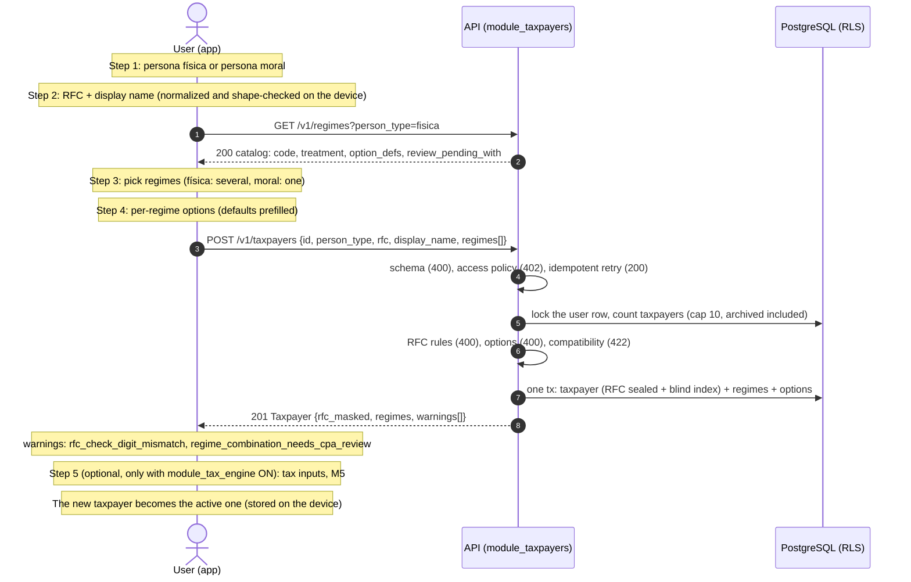

# Module M2: Taxpayers & Onboarding

| | |
|---|---|
| Flag | `module_taxpayers` (OFF by default) |
| Spec | [MODULE-taxpayers.md](../project-specs/MODULE-taxpayers.md) |
| Contract | [`docs/api/openapi.yaml`](../api/openapi.yaml), tag `Taxpayers`, `x-module: module_taxpayers` (frozen by M2-01, contract 0.4.0) |
| Gates | [M2-13 tech lead](../reviews/M2-13-tech-lead-gate.md) PASS, [M2-14 security](../reviews/M2-14-security-gate.md) PASS |
| Operations | [Taxpayers runbook](../runbooks/taxpayers.md) |
| Code | `backend/internal/taxpayers/` (domain, usecase, infra, adapter/http), `backend/migrations/20261013180000_regimes_catalog.sql`, `backend/migrations/20261013190000_taxpayers.sql`, `mobile/lib/features/taxpayers/` |

## What it does

A signed-in user registers one or more **taxpayers** (contribuyentes), each with its own RFC,
under one subscription. Each taxpayer holds one or more SAT tax **regimes**, each regime with
its own options and a period window. M2 also gives the app its **active taxpayer**: the
taxpayer that every later module (incomes, expenses, estimates, history) works on. The app
keeps that choice on the device; there is no server endpoint for it.

Backend modules M3 to M9 need a taxpayer, so they reach M2 through two ports:
`TaxpayerRegimeChecker` ("does taxpayer T, owned by the caller and not archived, hold regime R
in period P?") and `TaxpayerProfileReader` (person type, regimes, options and windows).

The API reference for each operation is generated from the contract (`make api-docs`, see
[API reference](#api-reference)). This page covers how the operations fit together.

| Operation | Endpoint | Read-only user (§2.10) |
|---|---|---|
| `listRegimes` | `GET /v1/regimes?person_type=fisica\|moral` | allowed |
| `listTaxpayers` | `GET /v1/taxpayers?include_archived=` | allowed |
| `createTaxpayer` | `POST /v1/taxpayers` | `402` |
| `getTaxpayer` / `updateTaxpayer` | `GET` / `PATCH /v1/taxpayers/{taxpayerId}` | `GET` allowed, `PATCH` `402` |
| `deleteTaxpayer` | `DELETE /v1/taxpayers/{taxpayerId}?confirm=true` | allowed |
| `archiveTaxpayer` / `unarchiveTaxpayer` | `POST /v1/taxpayers/{taxpayerId}/archive` / `…/unarchive` | archive allowed, unarchive `402` |
| `addTaxpayerRegime` | `POST /v1/taxpayers/{taxpayerId}/regimes` | `402` |
| `updateTaxpayerRegime` | `PATCH /v1/taxpayers/{taxpayerId}/regimes/{regimeCode}` | `402` |
| `archiveTaxpayerRegime` | `DELETE /v1/taxpayers/{taxpayerId}/regimes/{regimeCode}?end_period=&confirm=` | allowed |

Every operation needs a bearer token. A taxpayer id that belongs to another user answers
`404 not_found`, the same as an id that does not exist.

## Onboarding flow

The order is fixed (OD-3): person type first, because it filters the regime catalog and sets
the RFC length. One `createTaxpayer` call writes the taxpayer, its regimes and their options
in one transaction, so a failure leaves nothing behind.



On launch the app picks the stored active taxpayer if it is still in the user's list and not
archived; otherwise the first non-archived taxpayer by creation date; with none, it starts
onboarding. At 10 taxpayers the onboarding opens on a "limit reached" step instead of
step 1, and a user known to be read-only sees the paywall first.

### Try it locally

These requests were run against `make -C backend api` with `module_auth` and
`module_taxpayers` ON. Get `ACCESS` from the [M1 walkthrough](auth.md#try-it-locally)
(steps 1 to 5).

```sh
API=http://localhost:3000
AUTH="Authorization: Bearer $ACCESS"

# 1. Catalog for the person type chosen in step 1.
curl -s "$API/v1/regimes?person_type=fisica" -H "$AUTH" \
  | jq -c '.items[] | {code, treatment, options: [.option_defs[].key]}'

# 2. Create the taxpayer, its regimes and options in one transaction: 201.
#    Omitted options get their defaults; start_period defaults to the current month.
TAXPAYER=$(curl -s -X POST "$API/v1/taxpayers" -H "$AUTH" -H 'Content-Type: application/json' -d '{
  "person_type": "fisica", "rfc": "GOMA800101AB6", "display_name": "Ana (personal)",
  "regimes": [
    {"regime_code": "606", "options": {"deduction_mode": "blind_35"}},
    {"regime_code": "625", "options": {"activities": ["goods_services"]}}
  ]}')
echo "$TAXPAYER" | jq -c '{id, rfc_masked, regimes: [.regimes[] | {regime_code, start_period, options}], warnings}'
TAXPAYER_ID=$(echo "$TAXPAYER" | jq -r .id)

# 3. Correct the RFC with a wrong check digit: 200, accepted with a warning (D-RFC).
curl -s -X PATCH "$API/v1/taxpayers/$TAXPAYER_ID" -H "$AUTH" -H 'Content-Type: application/json' \
  -d '{"rfc": "GOMA800101AB5"}' | jq -c '{rfc_masked, warnings}'

# 4. A regime that may not overlap one already held: 422 invalid_regime_combination.
curl -s -X POST "$API/v1/taxpayers/$TAXPAYER_ID/regimes" -H "$AUTH" -H 'Content-Type: application/json' \
  -d '{"regime_code": "616"}' | jq -c .error

# 5. A pair still under CPA review: 201, one regime_combination_needs_cpa_review warning per pair.
curl -s -X POST "$API/v1/taxpayers/$TAXPAYER_ID/regimes" -H "$AUTH" -H 'Content-Type: application/json' \
  -d '{"regime_code": "621", "options": {"rif_year": "3"}}' | jq -c '{regime_code, warnings}'

# 6. Archive, then unarchive: 200 and 200.
curl -s -o /dev/null -w '%{http_code}\n' -X POST "$API/v1/taxpayers/$TAXPAYER_ID/archive" -H "$AUTH"
curl -s -o /dev/null -w '%{http_code}\n' -X POST "$API/v1/taxpayers/$TAXPAYER_ID/unarchive" -H "$AUTH"

# 7. Delete is irreversible: 400 without confirm=true, 204 with it.
curl -s -o /dev/null -w '%{http_code}\n' -X DELETE "$API/v1/taxpayers/$TAXPAYER_ID" -H "$AUTH"
curl -s -o /dev/null -w '%{http_code}\n' -X DELETE "$API/v1/taxpayers/$TAXPAYER_ID?confirm=true" -H "$AUTH"
```

Step 2 returns `"rfc_masked":"GOMA******AB6"` and `"warnings":null`. Step 3 returns
`"rfc_masked":"GOMA******AB5"` with
`{"code":"rfc_check_digit_mismatch","field":"rfc","message":"Revisa tu RFC; la homoclave no coincide con el dígito verificador."}`.
Step 4 returns the catalog reason as `message` and `details[0].code = incompatible`. The full
RFC never appears in a response, an error or a log line.

## RFC handling

Rules: [spec §2.2](../project-specs/MODULE-taxpayers.md#22-rfc-value-object-m2-04-table-driven-tdd).

| Step | What happens |
|---|---|
| Normalize | Trim, upper-case, NFC, remove inner spaces and `-`. `" goma-800101 ab6 "` is `GOMA800101AB6`. The app normalizes too, so the user may type spaces or dashes |
| Validate (rejects, `400 validation_failed`) | Length for the person type (física 13, moral 12): `rfc_length_mismatch`. Alphabet, and a last character in `[0-9A]`: `rfc_format`. A real calendar date `YYMMDD`: `rfc_date`. The generic RFCs `XAXX010101000` and `XEXX010101000`: `rfc_generic` |
| Check digit (warns, never rejects) | SAT módulo 11. About 1.5 % of real SAT-issued RFCs fail the published algorithm, so a mismatch is accepted and the response carries the warning `rfc_check_digit_mismatch` on field `rfc`. The app asks the user to double-check. Decision **D-RFC**, [ADR-0006](../adr/0006-rfc-check-digit-is-a-warning.md) |
| Not done | No lookup against the SAT (PRD NG6) |

Storage, at a high level (requirements S-1 to S-4 in
[spec §5](../project-specs/MODULE-taxpayers.md#5-security-requirements-gate-m2-14), verified
in [M2-14 §1](../reviews/M2-14-security-gate.md#1-evidence)):

- **Encrypted.** The RFC is sealed with AES-256-GCM under `RFC_ENC_KEY`. The ciphertext is
  bound to the key id, the taxpayer id and the user id, so a ciphertext copied to another row
  does not decrypt. The row id is generated before sealing for that reason.
- **Blind index.** Duplicates are found through `HMAC-SHA256(RFC_INDEX_PEPPER, user_id ‖ RFC)`.
  Including the user id means the same RFC under two users gives two unrelated hashes, so
  uniqueness is per user and nothing links accounts. Another user may register the same RFC.
- **Masked on the way out.** Only `rfc_masked` (`GOMA******AB6` for a física,
  `EEJ******QK2` for a moral) leaves the server. No endpoint returns the RFC, and errors and
  logs never echo it.
- **Correctable.** `PATCH rfc` (OQ-1) re-validates, re-seals and re-hashes for the same row,
  and is audited as `taxpayer.rfc_corrected`. The person type cannot change.

### Keys (M2-07)

Both keys are 32-byte hex secrets from the secret manager (`RFC_ENC_KEY_ID` names the
encryption key, default 1). The API refuses to start when either is missing outside dev, or
when any two of `RFC_ENC_KEY`, `RFC_INDEX_PEPPER` and `AUTH_EMAIL_PEPPER` (or any other
`AUTH_*` key) are equal, in every environment. In dev a missing key becomes an ephemeral one,
logged as a warning: duplicate-RFC detection then resets on restart. `make -C backend init-env`
generates both locally (`CC_RFC_ENC_KEY`, `CC_RFC_INDEX_PEPPER` in `infra/local/.env`).

**Neither key may be rotated yet.** Nothing re-seals stored RFCs until the M9 re-seal job
ships; see [runbook §2](../runbooks/taxpayers.md#2-do-not-rotate-rfc_enc_key-until-the-m9-re-seal-job-exists).

## Regimes

### Catalog and support levels

`GET /v1/regimes?person_type=` returns the SAT `c_RegimenFiscal` catalog for one person type.
The key is `(code, person_type)`: 626 física (RESICO PF) and 626 moral (RESICO PM) are
different regimes, and 610 exists for both. Every key is selectable; `treatment` says how much
the app can do with it.

| `treatment` | Meaning | Física | Moral |
|---|---|---|---|
| `full` | The app estimates the tax | 606, 612, 625 (definitive option), 626 | 601, 626 |
| `partial` | Some of the tax, with stated gaps | 621 (RIF, legacy), 625 (non-definitive) | 603 (IVA only), 622 (IVA only) |
| `informational` | Registered and explained, not calculated | 605, 607, 608, 610, 611, 614, 615, 616 | 610, 620, 623, 624 |

Source: [spec §2.3](../project-specs/MODULE-taxpayers.md#23-regime-catalog-regimes-regime_compatibility-global-seeded-in-m2-02).
The plain-language `explanation` of each informational and partial regime lands in M5-19.

Each regime carries `option_defs`: the options the user sets per regime (for example 606
`deduction_mode`, 625 `activities`, 621 `rif_year`). The API response is the authority for the
current list; [spec §2.4](../project-specs/MODULE-taxpayers.md#24-per-regime-options-regimesoption_defs-validated-server-side)
explains each one. Options with a default are filled in server-side. An unknown key, a wrong
type or a missing required option answers `400` naming `regimes.N.options.<key>`.

### Compatibility

Which regimes one taxpayer may hold together is **data**, not code: the table
`regime_compatibility` holds one row per pair of regimes of the same person type. The rules,
and the current seed, are in
[spec §2.5](../project-specs/MODULE-taxpayers.md#25-compatibility-data-not-code); this page
does not repeat them.

| Pair verdict | Result |
|---|---|
| The windows do not overlap | Allowed. Example: RESICO PF 626 ends `2026-06`, 612 starts `2026-07` |
| Overlap, `allowed = true` | Allowed |
| Overlap, `allowed = false` | `422 invalid_regime_combination`; `message` is the pair's `reason` |
| Overlap, `needs_cpa_review = true` | **Allowed, with a warning.** A verdict nobody has verified never blocks a user (database CHECK). The response carries `regime_combination_needs_cpa_review` per pair (field `regimes.N.regime_code` on create, `regime_code` on add), with the reason as `message` |

`GET /v1/regimes` also returns `review_pending_with` for each regime, so the app can name the
pair before the user submits. The open verdicts are listed for the owner's accountant in
[CPA-REVIEW.md](../reviews/CPA-REVIEW.md) (OQ-6); a corrected verdict ships as a forward
migration ([runbook §3](../runbooks/taxpayers.md#3-update-the-regimes-catalog)).

### Period windows

- `start_period` is `YYYY-MM`, from `2022-01` up to the current month (America/Mexico_City);
  it defaults to the current month.
- Ending a regime (`DELETE …/regimes/{code}?end_period=`) sets `end_period`. Records already
  in that regime need `confirm=true` (`409 regime_has_records` without it), and records after
  `end_period` refuse it (`422`, `records_after_end_period`). The last active regime cannot be
  ended: archive the taxpayer instead (`422`, `last_active_regime`).
- Adding an ended regime again reopens the same row: `end_period` is cleared.

## Limits and rules

| Rule | Behaviour |
|---|---|
| **Cap of 10** (OD-2) | At most 10 taxpayers per user, for every plan and the trial. Archived taxpayers count; deleting one frees a slot. The count is taken under a lock on the user row, so concurrent creates cannot overshoot. An 11th answers `422 taxpayer_limit_reached`, not `402`: paying does not lift it |
| **Idempotent create** | A retry with a client `id` the caller already owns answers `200` with the existing taxpayer, even at 10 of 10 or for a read-only user. An `id` owned by someone else answers a generic `409 conflict` |
| **Duplicate RFC** | The same RFC twice in one account, in any spelling, answers `409 rfc_already_registered`, archived taxpayers included. Unarchive the old one instead |
| **Read-only** (OQ-8) | A user with no running trial and no `pro`/`comp` plan can read, archive and delete. Create, unarchive, add regime, rename, `PATCH rfc` and option changes answer `402 entitlement_required` and change nothing |
| **Archived taxpayer** | Kept, readable and still counting toward the cap; its RFC stays reserved. Writes (rename, regime changes, and later incomes and expenses) answer `422 business_rule_violation`, detail `taxpayer_archived`. Reversible with unarchive |
| **Delete** | Irreversible and needs `confirm=true`. It cascades to the taxpayer's regimes and to everything later modules hang on it (incomes, expenses, tax inputs, history). Trial usage counters are not refunded |
| **Write budget** | 30 mutations per user per hour across the 8 M2 write operations, then `429` with `Retry-After` |

## Flag behaviour (`module_taxpayers`)

- OFF (the default): all 11 operations, `GET /v1/regimes` included, answer `404 not_found`
  with the standard error envelope, before authentication. The app shows no onboarding and no
  switcher; Home shows only the account area.
- ON: the operations behave as described here. A running API picks up a change within 5 s.
- Modules M3 to M9 need a taxpayer: with `module_taxpayers` OFF their routes answer `404` too,
  whatever their own flag says.
- Account deletion (M1) still removes the user's taxpayers when the flag is OFF.
- The flag suites cover every operation with the flag ON and OFF
  (`backend/adapter/http/gen/taxpayers_module_test.go`,
  `backend/cmd/api/taxpayers_preset_smoke_integration_test.go`,
  `mobile/test/features/taxpayers/taxpayers_flag_test.dart`).
- `module_taxpayers` is a member of `demo_core`, `demo_monetization` and `demo_full`.
- **Do not enable it in staging or production** until every precondition in
  [runbook §5](../runbooks/taxpayers.md#5-enable-module_taxpayers-in-a-shared-environment) holds.

```sh
make -C backend flags ARGS="enable module_taxpayers"
make -C backend flags ARGS="disable module_taxpayers"
```

## Errors

Every error uses the single envelope `ErrorResponse`. `error.code` is the stable value to
branch on; `details[].field` is the dotted path inside the body (`regimes.0.options.rif_year`)
or the bare parameter name (`taxpayerId`, `end_period`), and `details[].code` carries the
domain rule (`rfc_date`, `taxpayer_archived`, ...; see each operation in the contract).
An RFC is never echoed in an error.

Two outcomes are **not** errors: a check-digit mismatch and a regime pair under CPA review.
Both succeed and add an entry to `warnings` (`Taxpayer.warnings` on create and update,
`TaxpayerRegime.warnings` on add regime).

The table below is **generated from the contract** by `make api-error-tables`; do not edit
it by hand. CI (`make api-error-tables-check`) fails when it differs from `openapi.yaml`.

<!-- BEGIN GENERATED error-table module_taxpayers -->
| Operation | Endpoint | HTTP | `error.code` | When |
|---|---|---|---|---|
| `listRegimes` | `GET /v1/regimes` | 400 | `validation_failed` | `person_type` is missing or not `fisica`/`moral`. |
| `listRegimes` | `GET /v1/regimes` | 401 | `unauthorized` | Missing, invalid or expired credentials. |
| `listRegimes` | `GET /v1/regimes` | 404 | `not_found` | Resource does not exist, belongs to another user, or its module is disabled. |
| `listRegimes` | `GET /v1/regimes` | 429 | `rate_limited` | Rate limit exceeded. |
| `listRegimes` | `GET /v1/regimes` | 500 | `internal_error` | Unexpected server error. |
| `listTaxpayers` | `GET /v1/taxpayers` | 400 | `validation_failed` | Input does not match the contract. |
| `listTaxpayers` | `GET /v1/taxpayers` | 401 | `unauthorized` | Missing, invalid or expired credentials. |
| `listTaxpayers` | `GET /v1/taxpayers` | 404 | `not_found` | Resource does not exist, belongs to another user, or its module is disabled. |
| `listTaxpayers` | `GET /v1/taxpayers` | 429 | `rate_limited` | Rate limit exceeded. |
| `listTaxpayers` | `GET /v1/taxpayers` | 500 | `internal_error` | Unexpected server error. |
| `createTaxpayer` | `POST /v1/taxpayers` | 400 | `validation_failed` | Input does not match the contract, or an RFC, regime, option or period rule (`details[].code`: see the operation description). |
| `createTaxpayer` | `POST /v1/taxpayers` | 401 | `unauthorized` | Missing, invalid or expired credentials. |
| `createTaxpayer` | `POST /v1/taxpayers` | 402 | `entitlement_required` | Trial ended or cap reached and no active plan (read-only access). |
| `createTaxpayer` | `POST /v1/taxpayers` | 404 | `not_found` | Resource does not exist, belongs to another user, or its module is disabled. |
| `createTaxpayer` | `POST /v1/taxpayers` | 409 | `conflict`, `rfc_already_registered` | The RFC is already registered in the caller's account (active or archived), or the client `id` exists outside the caller's scope (generic, reveals nothing). |
| `createTaxpayer` | `POST /v1/taxpayers` | 422 | `invalid_regime_combination`, `taxpayer_limit_reached` | Two regimes in the body overlap in time and are incompatible, or the user already has 10 taxpayers (archived included). |
| `createTaxpayer` | `POST /v1/taxpayers` | 429 | `rate_limited` | Rate limit exceeded. |
| `createTaxpayer` | `POST /v1/taxpayers` | 500 | `internal_error` | Unexpected server error. |
| `getTaxpayer` | `GET /v1/taxpayers/{taxpayerId}` | 400 | `validation_failed` | Input does not match the contract. |
| `getTaxpayer` | `GET /v1/taxpayers/{taxpayerId}` | 401 | `unauthorized` | Missing, invalid or expired credentials. |
| `getTaxpayer` | `GET /v1/taxpayers/{taxpayerId}` | 404 | `not_found` | Resource does not exist, belongs to another user, or its module is disabled. |
| `getTaxpayer` | `GET /v1/taxpayers/{taxpayerId}` | 429 | `rate_limited` | Rate limit exceeded. |
| `getTaxpayer` | `GET /v1/taxpayers/{taxpayerId}` | 500 | `internal_error` | Unexpected server error. |
| `updateTaxpayer` | `PATCH /v1/taxpayers/{taxpayerId}` | 400 | `validation_failed` | Input does not match the contract, or the corrected RFC is invalid. |
| `updateTaxpayer` | `PATCH /v1/taxpayers/{taxpayerId}` | 401 | `unauthorized` | Missing, invalid or expired credentials. |
| `updateTaxpayer` | `PATCH /v1/taxpayers/{taxpayerId}` | 402 | `entitlement_required` | Trial ended or cap reached and no active plan (read-only access). |
| `updateTaxpayer` | `PATCH /v1/taxpayers/{taxpayerId}` | 404 | `not_found` | Resource does not exist, belongs to another user, or its module is disabled. |
| `updateTaxpayer` | `PATCH /v1/taxpayers/{taxpayerId}` | 409 | `rfc_already_registered` | The corrected RFC is already registered in the caller's account. |
| `updateTaxpayer` | `PATCH /v1/taxpayers/{taxpayerId}` | 422 | `business_rule_violation` | The taxpayer is archived; unarchive it first. |
| `updateTaxpayer` | `PATCH /v1/taxpayers/{taxpayerId}` | 429 | `rate_limited` | Rate limit exceeded. |
| `updateTaxpayer` | `PATCH /v1/taxpayers/{taxpayerId}` | 500 | `internal_error` | Unexpected server error. |
| `deleteTaxpayer` | `DELETE /v1/taxpayers/{taxpayerId}` | 400 | `validation_failed` | `confirm=true` is missing, or the input does not match the contract. |
| `deleteTaxpayer` | `DELETE /v1/taxpayers/{taxpayerId}` | 401 | `unauthorized` | Missing, invalid or expired credentials. |
| `deleteTaxpayer` | `DELETE /v1/taxpayers/{taxpayerId}` | 404 | `not_found` | Resource does not exist, belongs to another user, or its module is disabled. |
| `deleteTaxpayer` | `DELETE /v1/taxpayers/{taxpayerId}` | 429 | `rate_limited` | Rate limit exceeded. |
| `deleteTaxpayer` | `DELETE /v1/taxpayers/{taxpayerId}` | 500 | `internal_error` | Unexpected server error. |
| `archiveTaxpayer` | `POST /v1/taxpayers/{taxpayerId}/archive` | 400 | `validation_failed` | Input does not match the contract. |
| `archiveTaxpayer` | `POST /v1/taxpayers/{taxpayerId}/archive` | 401 | `unauthorized` | Missing, invalid or expired credentials. |
| `archiveTaxpayer` | `POST /v1/taxpayers/{taxpayerId}/archive` | 404 | `not_found` | Resource does not exist, belongs to another user, or its module is disabled. |
| `archiveTaxpayer` | `POST /v1/taxpayers/{taxpayerId}/archive` | 429 | `rate_limited` | Rate limit exceeded. |
| `archiveTaxpayer` | `POST /v1/taxpayers/{taxpayerId}/archive` | 500 | `internal_error` | Unexpected server error. |
| `unarchiveTaxpayer` | `POST /v1/taxpayers/{taxpayerId}/unarchive` | 400 | `validation_failed` | Input does not match the contract. |
| `unarchiveTaxpayer` | `POST /v1/taxpayers/{taxpayerId}/unarchive` | 401 | `unauthorized` | Missing, invalid or expired credentials. |
| `unarchiveTaxpayer` | `POST /v1/taxpayers/{taxpayerId}/unarchive` | 402 | `entitlement_required` | Trial ended or cap reached and no active plan (read-only access). |
| `unarchiveTaxpayer` | `POST /v1/taxpayers/{taxpayerId}/unarchive` | 404 | `not_found` | Resource does not exist, belongs to another user, or its module is disabled. |
| `unarchiveTaxpayer` | `POST /v1/taxpayers/{taxpayerId}/unarchive` | 429 | `rate_limited` | Rate limit exceeded. |
| `unarchiveTaxpayer` | `POST /v1/taxpayers/{taxpayerId}/unarchive` | 500 | `internal_error` | Unexpected server error. |
| `addTaxpayerRegime` | `POST /v1/taxpayers/{taxpayerId}/regimes` | 400 | `validation_failed` | Input does not match the contract, or a regime, option or period rule. |
| `addTaxpayerRegime` | `POST /v1/taxpayers/{taxpayerId}/regimes` | 401 | `unauthorized` | Missing, invalid or expired credentials. |
| `addTaxpayerRegime` | `POST /v1/taxpayers/{taxpayerId}/regimes` | 402 | `entitlement_required` | Trial ended or cap reached and no active plan (read-only access). |
| `addTaxpayerRegime` | `POST /v1/taxpayers/{taxpayerId}/regimes` | 404 | `not_found` | Resource does not exist, belongs to another user, or its module is disabled. |
| `addTaxpayerRegime` | `POST /v1/taxpayers/{taxpayerId}/regimes` | 409 | `conflict` | The regime is already active for this taxpayer. |
| `addTaxpayerRegime` | `POST /v1/taxpayers/{taxpayerId}/regimes` | 422 | `business_rule_violation`, `invalid_regime_combination` | The regime overlaps an incompatible one, or the taxpayer is archived. |
| `addTaxpayerRegime` | `POST /v1/taxpayers/{taxpayerId}/regimes` | 429 | `rate_limited` | Rate limit exceeded. |
| `addTaxpayerRegime` | `POST /v1/taxpayers/{taxpayerId}/regimes` | 500 | `internal_error` | Unexpected server error. |
| `updateTaxpayerRegime` | `PATCH /v1/taxpayers/{taxpayerId}/regimes/{regimeCode}` | 400 | `validation_failed` | Input does not match the contract, or an option fails its definition. |
| `updateTaxpayerRegime` | `PATCH /v1/taxpayers/{taxpayerId}/regimes/{regimeCode}` | 401 | `unauthorized` | Missing, invalid or expired credentials. |
| `updateTaxpayerRegime` | `PATCH /v1/taxpayers/{taxpayerId}/regimes/{regimeCode}` | 402 | `entitlement_required` | Trial ended or cap reached and no active plan (read-only access). |
| `updateTaxpayerRegime` | `PATCH /v1/taxpayers/{taxpayerId}/regimes/{regimeCode}` | 404 | `not_found` | Resource does not exist, belongs to another user, or its module is disabled. |
| `updateTaxpayerRegime` | `PATCH /v1/taxpayers/{taxpayerId}/regimes/{regimeCode}` | 422 | `business_rule_violation` | The taxpayer is archived; unarchive it first. |
| `updateTaxpayerRegime` | `PATCH /v1/taxpayers/{taxpayerId}/regimes/{regimeCode}` | 429 | `rate_limited` | Rate limit exceeded. |
| `updateTaxpayerRegime` | `PATCH /v1/taxpayers/{taxpayerId}/regimes/{regimeCode}` | 500 | `internal_error` | Unexpected server error. |
| `archiveTaxpayerRegime` | `DELETE /v1/taxpayers/{taxpayerId}/regimes/{regimeCode}` | 400 | `validation_failed` | `end_period` is missing, malformed or out of range. |
| `archiveTaxpayerRegime` | `DELETE /v1/taxpayers/{taxpayerId}/regimes/{regimeCode}` | 401 | `unauthorized` | Missing, invalid or expired credentials. |
| `archiveTaxpayerRegime` | `DELETE /v1/taxpayers/{taxpayerId}/regimes/{regimeCode}` | 404 | `not_found` | Resource does not exist, belongs to another user, or its module is disabled. |
| `archiveTaxpayerRegime` | `DELETE /v1/taxpayers/{taxpayerId}/regimes/{regimeCode}` | 409 | `conflict`, `regime_has_records` | The regime has records and `confirm=true` was not sent, or the regime has already ended. |
| `archiveTaxpayerRegime` | `DELETE /v1/taxpayers/{taxpayerId}/regimes/{regimeCode}` | 422 | `business_rule_violation` | Records exist after `end_period`, it is the last active regime, or the taxpayer is archived. |
| `archiveTaxpayerRegime` | `DELETE /v1/taxpayers/{taxpayerId}/regimes/{regimeCode}` | 429 | `rate_limited` | Rate limit exceeded. |
| `archiveTaxpayerRegime` | `DELETE /v1/taxpayers/{taxpayerId}/regimes/{regimeCode}` | 500 | `internal_error` | Unexpected server error. |
<!-- END GENERATED error-table module_taxpayers -->

## Decisions

Full text in [MODULE-taxpayers §9](../project-specs/MODULE-taxpayers.md#9-decisions-coordinator-2026-10-13--all-decided)
and the owner decisions in [§1](../project-specs/MODULE-taxpayers.md#1-scope).

| # | Decision | Effect |
|---|---|---|
| OD-1 | Many taxpayers per user, one subscription | No per-RFC pricing |
| OD-2 | Cap of 10 for every plan, counted under a lock | `422 taxpayer_limit_reached` |
| OD-3 | Person type first | It filters the catalog and fixes the RFC length; it never changes after create |
| OD-4, D-RFC | RFC required; check digit warns, never rejects; no SAT lookup | `warnings[].code = rfc_check_digit_mismatch` ([ADR-0006](../adr/0006-rfc-check-digit-is-a-warning.md)) |
| OD-5 | RFC encrypted with a per-user blind index | Only `rfc_masked` is returned |
| OD-7 | One active taxpayer at a time, chosen in a switcher | Stored on the device; a combined view is later (Q14) |
| OQ-1 | A mistyped RFC is corrected, not recreated | `PATCH rfc`, re-sealed and audited |
| OQ-2 | Archived taxpayers can be restored | `POST …/unarchive` |
| OQ-3 | Year-to-date tax inputs are an optional step 5 | Shown only with `module_tax_engine` ON (M5) |
| OQ-4 | The cap is not raised on request in v1 | Fixed at 10 |
| OQ-5 | Re-adding an ended regime reopens its row | `end_period` cleared, `start_period` kept |
| OQ-6 | Compatibility matrix ships as seeded, unverified pairs allowed with a warning | CPA review before launch ([CPA-REVIEW.md](../reviews/CPA-REVIEW.md)) |
| OQ-7 | Option changes are not versioned by period | The app warns that a change applies to every period of the regime |
| OQ-8 | Read-only users may read, archive and delete only | Other writes answer `402` |
| OQ-9 | Archived taxpayers count toward the cap | Only deleting frees a slot |

## API reference

```sh
make api-docs                 # build/api-docs/index.html, rendered from docs/api/openapi.yaml
make api-error-tables         # regenerate the error table on this page after a contract change
```

## Known limits

The deferred items are listed in [M2-14 §4](../reviews/M2-14-security-gate.md#4-carried-m2-security-follow-ups),
in [M2-13 follow-ups](../reviews/M2-13-tech-lead-gate.md#follow-ups-not-fixed-here) and in the
[PLAN M2 follow-ups](../project-specs/PLAN-control-contable.md#m2-follow-ups). The ones a user
or an operator can notice:

- The compatibility verdicts marked for CPA review only warn; some pairs the spec describes as
  refused are allowed with a warning until the CPA settles them (M2-13 FU1).
- A duplicate RFC always gets the generic `rfc_already_registered` message, even when the
  existing taxpayer is archived (M2-13 FU2).
- `RFC_ENC_KEY` and `RFC_INDEX_PEPPER` cannot be rotated until M9 (G-2).
- Ending a regime checks the taxpayer's incomes and expenses since M3/M4 (G-1 closed); see
  [incomes and expenses runbook §4](../runbooks/incomes-expenses.md#4-regime-end-and-records).
